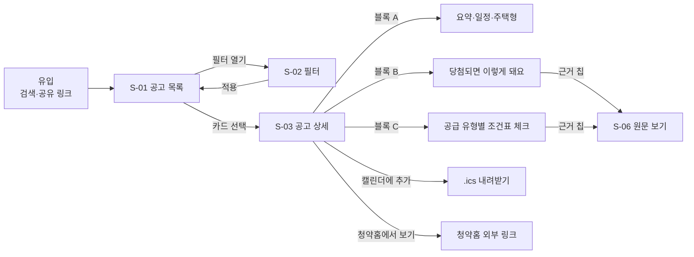
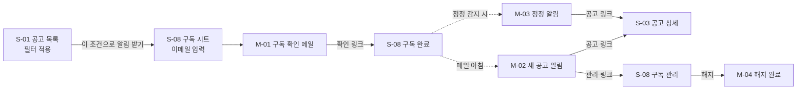

# 서비스 기획서: 청담

- 작성일: 2026-10-19 / 수정일: 2026-10-20
- 상태: 초안
- 상태: 초안
- 관련 문서: [PRD](PRD.md), [기술 노트](TECH_NOTES.md), [MVP 일정](SCHEDULE.md)

**목차**

0. [문서 안내](#0-문서-안내)
1. [PRD 기능 ↔ 화면 추적표](#1-prd-기능--화면-추적표)
2. [사용자 흐름](#2-사용자-흐름)
3. [정보 구조](#3-정보-구조)
4. [공통 정책 P-01~P-09](#4-공통-정책)
5. [문구 가이드](#5-문구-가이드)
6. [측정](#6-측정)
7. [결정 사항](#7-결정-사항)

**하위 문서**

| 문서 | 내용 | 주로 읽는 사람 |
|---|---|---|
| [spec/SCREENS.md](spec/SCREENS.md) | 화면 S-01, S-02, S-03(블록 A~D), S-06, S-09, 화면 예외, 검수 #1~#17 | B, QA |
| [spec/ALERTS.md](spec/ALERTS.md) | 구독 화면 S-08, 메일 M-01~M-04, 구독 데이터, 알림 정책 P-17~P-20, 알림 예외, 검수 #18~#22 | A·B |
| [spec/DATA.md](spec/DATA.md) | 가공 필드·캘린더 이벤트, 추출 결과, 툴팁 용어, 수집·정정·추출 정책 P-10~P-16, 데이터 예외 | A, B의 API 연동 |
| [spec/API.md](spec/API.md) | 프론트·백엔드 JSON API: 공통 규칙, 공고 목록·상세, 캘린더·PDF, 알림 구독 | B |

---

## 0. 문서 안내

**역할**
- [PRD](PRD.md)는 **무엇을, 왜** 만드는지 정한다. 이 문서는 PRD의 기능이 **화면과 메일에서 어떻게 보이고, 어떤 규칙으로 동작하는지** 정한다.
- 개발·디자인·QA가 이 문서만 보고 화면을 만들고 검수할 수 있는 수준을 목표로 한다.
- 서비스의 목표, 대상 고객, 페르소나, 원칙은 PRD 1~5장에 있으며 여기서 반복하지 않는다. 구현 조사 결과(API 필드, PDF 형식, 비용)는 [기술 노트](TECH_NOTES.md)에 있다.
- PRD와 내용이 다르면 PRD가 우선한다. 이 문서를 쓰다가 PRD를 바꿔야 할 내용을 발견하면 [7장](#7-결정-사항)에 적고 PRD에 반영한다.

**ID 체계**

| 접두어 | 뜻 | 있는 곳 |
|---|---|---|
| F | 기능 요구사항 (F1-1 등) | PRD 6장 |
| S | 화면 | 목록은 3.1, 상세는 [SCREENS.md](spec/SCREENS.md) (S-08만 [ALERTS.md](spec/ALERTS.md)) |
| M | 메일 | 목록은 3.2, 상세는 [ALERTS.md 2장](spec/ALERTS.md#2-메일) |
| P | 정책 | P-01~P-09 이 문서 4장, P-10~P-16 [DATA.md 4장](spec/DATA.md#4-수집정정추출-정책), P-17~P-20 [ALERTS.md 4장](spec/ALERTS.md#4-알림-정책) |
| E | 예외 케이스 | [DATA.md 5장](spec/DATA.md#5-데이터-예외)(E-01~E-04, E-10, E-11), [SCREENS.md 5장](spec/SCREENS.md#5-화면-예외)(E-05~E-09, E-19, E-20), [ALERTS.md 5장](spec/ALERTS.md#5-알림-예외)(E-14~E-18) |
| EV | 측정 이벤트 | 이 문서 6장 |
| # | 검수 시나리오 번호 | [SCREENS.md 6장](spec/SCREENS.md#6-검수-시나리오)(#1~#17), [ALERTS.md 6장](spec/ALERTS.md#6-검수-시나리오)(#18~#22) |
| D | 결정 사항 | 이 문서 7장 |

- 번호에 빈 곳이 있어도 다시 매기지 않는다. 다른 문서와 이슈가 ID로 참조하기 때문이다.

**화면 상세를 쓰는 틀**

목적 → 진입 → 와이어프레임 → 구성 요소(요구사항 ID 열 포함) → 동작 → 상태·예외 → 관련 검수 #. 와이어프레임은 배치를 보여 주기 위한 것이며 디자인 시안이 아니다.

---

## 1. PRD 기능 ↔ 화면 추적표

범위를 바꿀 때 무엇이 함께 바뀌는지 보는 표다. 기능을 빼면 같은 줄의 화면 요소, 정책, 검수 시나리오도 함께 정리한다.

| 역할 | 기능 (PRD 6장) | 화면·메일 | 정책·데이터 | 검수 # |
|---|---|---|---|---|
| 바닥 | F1-1~F1-3 수집 | (화면 없음) | P-10, P-12, P-13, [데이터 1장](spec/DATA.md#1-공고주택형-가공-필드) | - |
| 바닥 | F1-4~F1-6 신규·정정 감지 | S-01 `정정` 배지, S-03 블록 D | P-08, P-11, P-16 | 12 |
| 놓치지 않게 | F3-1~F3-10 검색·필터·정렬 | S-01, S-02 | P-01~P-04 | 1~7 |
| 놓치지 않게 | F3-11 조건 저장 | S-01 `이 조건으로 알림 받기`, S-08 | [구독 데이터](spec/ALERTS.md#3-구독-데이터) | 18 |
| 놓치지 않게 | F7-1 이메일 구독 | S-08, M-01 | [구독 데이터](spec/ALERTS.md#3-구독-데이터), P-09 | 18 |
| 놓치지 않게 | F7-2 새 공고 알림 | M-02 | P-17, P-18 | 19 |
| 놓치지 않게 | F7-3 정정 알림 | M-03 | P-08, P-18 | 20 |
| 놓치지 않게 | F7-4 관리·해지 | S-08 관리 화면, 모든 M- 하단, M-04 | P-19 | 21, 22 |
| 놓치지 않게 | F2-1 기본 요약·일정 | S-01 카드, S-03 블록 A | P-01, P-03 | 1, 13 |
| 놓치지 않게 | F2-7 캘린더(.ics) | S-03 블록 A·하단 고정 버튼, M-02, M-03 | [캘린더 이벤트](spec/DATA.md#1-공고주택형-가공-필드) | 17 |
| 후회하지 않게 | F8 당첨되면 이렇게 돼요 | S-03 블록 B | P-05, P-06, [추출 결과](spec/DATA.md#2-추출-결과) | 16 |
| 후회하지 않게 | F5 공급 유형별 조건표 | S-03 블록 C | P-05, P-06, P-09, [추출 결과](spec/DATA.md#2-추출-결과) | 8, 15 |
| 후회하지 않게 | F2-2, F2-3 추출·근거 검증 | S-03 블록 B·C | P-05, [추출 결과](spec/DATA.md#2-추출-결과) | 9 |
| 신뢰 | F2-4 용어 툴팁 | S-02, S-03 블록 B·C | [툴팁 용어](spec/DATA.md#3-툴팁-용어-설명-초안-법령-검수-전) | 14 |
| 신뢰 | F2-5 면책 안내 | S-03 상단, 모든 화면 푸터, 모든 M- 하단 | P-07 | 14 |
| 신뢰 | F2-6 정정 이력 | S-03 헤더·블록 D | P-08 | 12 |
| 신뢰 | F6-1, F6-2 원문 근거·원문 보기 | 근거 칩(모든 화면), S-06 | P-05 | 9 |

---

## 2. 사용자 흐름

PRD 7장 사용자 흐름을 화면 단위로 풀어 쓴다.

### 2.1 처음 방문: 찾기 → 확인 → 행동

- 1단계(여러 공고를 넓게 보기)는 S-01·S-02다. 사용자의 개인 사정을 묻지 않고, 필터는 모두 공고의 속성이다.
- 2단계(공고 하나를 깊게 보기)는 S-03이다. 상세 안에서 일정 → 당첨 후 제약 → 내 공급 유형 조건 순으로 내려가며 본다(PRD 8.3 정보 위계).
- 별도의 진단 화면은 없다. 조건표 체크는 상세 안에서 끝난다(D-10).

### 2.2 알림 구독: 조건 저장 → 메일 → 상세

### 2.3 흐름에서 뽑은 기획 포인트

페르소나(PRD 2.2)의 행동에서 뽑은 화면 규칙이다.

| 포인트 | 반영 위치 |
|---|---|
| 처음엔 "내 조건"이 아니라 "지역과 시기"로 넓게 본다 | 필터 기본값은 접수 예정 + 접수 중만 적용(S-02) |
| 필터를 바꿔 가며 여러 번 본다 → 조건이 사라지면 번거롭다 | 필터 상태를 URL에 남긴다(S-01). 그 조건을 그대로 알림 조건으로 저장한다(F3-11) |
| 결과 0건에서 이탈하기 쉽다 | 빈 결과에 조건 완화 제안(S-01) |
| 상세를 여러 개 번갈아 본다 | 상세 → 목록 복귀 시 스크롤 위치·필터 유지 |
| 숫자 기준(소득·기간)은 결국 원문을 봐야 한다 | 근거 칩 한 번으로 원문 해당 쪽 이동(S-06) |
| 공고를 봐 두고 접수일·계약일을 잊는다 | 상세와 알림 메일에 `캘린더에 추가`(F2-7) |
| "일단 넣고 당첨되면 읽는다" → 당첨 후 제약을 모르고 넣는다 | 조건표보다 위에 "당첨되면 이렇게 돼요" 블록(F8) |
| 알림 메일을 받은 날과 행동할 날이 다르다(공고→첫 접수 중앙값 10일) | M-02에 공고별 첫 접수일과 캘린더 버튼을 함께 둔다 |

---

## 3. 정보 구조

### 3.1 화면 목록

| ID | 화면 | URL | 관련 기능 |
|---|---|---|---|
| S-01 | 공고 목록 (홈) | `/` | F3-1~F3-10, F3-11 진입 |
| S-02 | 필터 | `/` 위 바텀시트(모바일) / 좌측 패널(데스크톱) | F3-1~F3-9 |
| S-03 | 공고 상세 | `/notices/{공고번호}` | F2, F5, F8, F6-1 |
| S-06 | 원문 보기 | `/notices/{공고번호}/original?page={쪽}` | F6-1, F6-2 |
| S-08 | 알림 구독·관리·해지 | 구독 시트(S-01 위), `/alerts/confirm?token=…`, `/alerts/manage?token=…`, `/alerts/unsubscribe?token=…` | F3-11, F7 |
| S-09 | 공통 (404, 오류, 약관, 개인정보처리방침, 서비스 안내) | `/terms`, `/privacy`, `/about` | F2-5 |

- `{공고번호}`는 `HOUSE_MANAGE_NO`다. APT와 무순위·잔여세대가 번호 대역으로 겹치지 않으므로([기술 노트 1장](TECH_NOTES.md#1-데이터-출처-조사-결과)) 하나의 경로를 쓴다.

- 화면 상세는 [spec/SCREENS.md](spec/SCREENS.md), S-08은 [spec/ALERTS.md](spec/ALERTS.md)에 있다.

### 3.2 메일 목록

| ID | 메일 | 보내는 때 | 관련 기능 |
|---|---|---|---|
| M-01 | 구독 확인 | 구독 신청 직후 | F7-1 |
| M-02 | 새 공고 알림 | 매일 아침, 조건에 맞는 새 공고가 있을 때만 | F7-2, F2-7 |
| M-03 | 정정 알림 | 매일 아침, 조건에 맞는 공고가 정정됐을 때만 | F7-3, F2-7 |
| M-04 | 해지 완료 | 해지 직후 | F7-4 |

- 메일 상세는 [spec/ALERTS.md 2장](spec/ALERTS.md#2-메일)에 있다.

### 3.3 내비게이션

- 상단 바: 로고(→ S-01), `알림 받기`(→ S-01의 구독 시트, 현재 필터로), 서비스 안내(→ `/about`).
- 하단 푸터(모든 화면): 면책 문구(P-07), 데이터 출처, 이용약관, 개인정보처리방침, 문의 메일.
- 모바일에서는 하단 탭 바를 쓰지 않는다. 화면이 적고 흐름이 목록 → 상세로 단순하기 때문이다.

---

## 4. 공통 정책

### 4.1 표시 규칙

#### P-01. 접수 상태

PRD F3-4의 규칙을 화면 표시 기준으로 구체화한다.

**접수 기간 계산**

| 공고 유형 | 접수 시작일 | 접수 종료일 |
|---|---|---|
| 일반 분양 (APT API) | `SPSPLY_RCEPT_BGNDE`, 없으면 1순위 시작일 중 가장 이른 날(`GNRL_RNK1_*_BGNDE`: 해당지역·기타경기·기타지역) | 2순위 종료일 중 가장 늦은 날(`GNRL_RNK2_*_ENDDE`), 없으면 1순위 종료일 중 가장 늦은 날 |
| 무순위 | `SUBSCRPT_RCEPT_BGNDE` | `SUBSCRPT_RCEPT_ENDDE` |
| 불법행위 재공급 | `SPSPLY_RCEPT_BGNDE` 또는 `GNRL_RCEPT_BGNDE`가 있으면 그중 이른 날, 없으면 `SUBSCRPT_RCEPT_BGNDE` | `GNRL_RCEPT_ENDDE`가 있으면 그 날, 없으면 `SUBSCRPT_RCEPT_ENDDE` |

**상태 판정** (기준 시각은 한국 시간, 날짜 단위)

| 상태 | 조건 | 목록 배지 |
|---|---|---|
| 접수 예정 | 오늘 < 접수 시작일 | `접수 예정 D-3` (D-day는 시작일 기준) |
| 접수 중 | 접수 시작일 ≤ 오늘 ≤ 접수 종료일 | `접수 중 D-2` (D-day는 종료일 기준, 당일은 `오늘 마감`) |
| 마감 | 오늘 > 접수 종료일 | `마감` |
| 일정 미정 | 시작일·종료일을 모두 구할 수 없음 | `일정 확인 필요` (E-05) |

- 접수 시작일과 종료일 사이에 접수가 없는 날(예: 특별공급과 1순위 사이)도 "접수 중"으로 본다. 상세 화면의 일정 타임라인에서 오늘이 어느 단계인지 보여 준다(S-03 블록 A).
- 상태는 저장하지 않고 조회 시점에 계산한다. 자정이 지나면 같은 공고의 상태가 바뀌어야 하므로, 목록 캐시는 한국 시간 자정에 무효화한다.

#### P-02. 공고 유형 표시

| 유형 | 판별 (PRD F3-3) | 배지 |
|---|---|---|
| 일반 분양 | APT 오퍼레이션으로 수집 | 표시하지 않음 (기본값) |
| 무순위 | 무순위·잔여세대 API, `HOUSE_SECD_NM` = "무순위" | `무순위` |
| 불법행위 재공급 | 무순위·잔여세대 API, `HOUSE_SECD_NM` = "불법행위 재공급" | `재공급` |

- 주택 구분(민영/국민)은 일반 분양에만 있으므로 카드에서 단지명 옆 보조 텍스트로 표시한다. 무순위·잔여세대는 표시하지 않는다.

#### P-03. 숫자·날짜 표기

| 항목 | 원본 | 표기 규칙 | 예 |
|---|---|---|---|
| 분양가 | `LTTOT_TOP_AMOUNT` 만원 단위 문자열 | 억·만 단위로 끊고 천 단위 쉼표, 1억 미만은 만 원 | `52340` → `5억 2,340만 원` |
| 분양가 범위(카드) | 주택형별 최고 분양가 | 최저~최고, 억 단위 소수 첫째 자리 | `3.2억 ~ 5.2억` |
| 전용면적 | `HOUSE_TY` 앞 숫자 | 소수 둘째 자리 반올림 + 타입 | `084.8860A` → `84.89㎡ A` |
| 전용면적 범위(카드) | | 정수, 같으면 하나만 | `59~84㎡` |
| 날짜 | `YYYY-MM-DD` | 올해면 연도 생략, 요일 표기 | `10.21(수)`, `2027.01.05(화)` |
| 입주 예정 | `MVN_PREARNGE_YM` | 연·월 | `203102` → `2031년 2월` |
| 세대수 | 정수 | 천 단위 쉼표 + 세대 | `1,204세대` |
| 값 없음 | `null`, 빈 문자열 | `-` 대신 이유를 쓴다 | `공고문 확인`, `해당 없음` |

- 평 환산은 표기하지 않는다. 평은 보통 공급면적 기준인데 무순위 공고에는 공급면적이 없어([기술 노트 1장](TECH_NOTES.md#1-데이터-출처-조사-결과)) 공고마다 기준이 달라지기 때문이다.
- PDF에서 뽑은 숫자(기간, 비율, 금액)는 P-03으로 다시 쓰지 않고 원문 표기 그대로 보여 준다(5.2).

#### P-04. 정보가 없는 공고

- 무순위·잔여세대 공고에는 주택 구분, 특별공급 유형별 세대수, 규제 여부가 없다([기술 노트 1장](TECH_NOTES.md#1-데이터-출처-조사-결과)).
- **필터:** 해당 필터를 고르면 그 공고는 결과에서 빠지고, 목록 상단에 안내 배너를 띄운다.
  - 문구: `주택 구분·특별공급 정보가 없는 무순위·재공급 공고 12건은 제외했어요.` + `[포함해서 보기]`
  - `[포함해서 보기]`는 정보가 없는 필터(F3-2, F3-5)만 풀고 다른 조건은 유지한다.
- **상세:** 해당 항목을 숨기지 않고 `이 공고 유형은 청약홈에서 이 정보를 제공하지 않아요. 공고문에서 확인해 주세요.`로 표시한다. 항목이 아예 안 보이면 "없는 것"으로 오해할 수 있기 때문이다.
- **알림:** 저장한 조건에 F3-2·F3-5가 있으면 무순위·재공급 공고는 알림에서도 빠진다. 구독 시트(S-08)에 같은 안내를 보여 준다.

### 4.2 신뢰 규칙

#### P-05. 원문 근거 표시

PRD 5.1 "모든 정보에 원문 근거"를 화면 규칙으로 정한다.

**근거 칩**

- PDF에서 추출한 항목(당첨 후 제약, 자격 조건)마다 오른쪽에 근거 칩을 붙인다: `p.11 ›`. 근거가 여러 쪽이면 `p.3 외 2 ›`.
- API에서 온 항목(일정, 세대수, 분양가)에는 근거 칩 대신 섹션 단위로 `출처: 청약홈` 표기를 붙인다.
- 칩을 누르면 근거 미리보기를 띄운다(모바일 바텀시트, 데스크톱 팝오버).
  - 쪽 번호, 근거 문구(최대 300자, 넘으면 말줄임), `[원문에서 보기]` 버튼(→ S-06 해당 쪽).

**검증 상태별 표시**

| 상태 | 조건 ([기술 노트 2장](TECH_NOTES.md#2-기술-고려사항)) | 화면 |
|---|---|---|
| 확인됨 | 근거 문구가 해당 쪽 원문에 문자열로 있음 | 항목과 근거 칩을 그대로 표시 |
| 확인 필요 | 근거 문구가 원문에서 확인되지 않거나 근거가 없음 | 항목을 회색으로 표시하고 `원문 확인 필요` 라벨. 블록 C에서는 체크박스를 달지 않는다 |
| 추출 실패 | 공고 전체 추출 실패 | 블록 B·C 대신 실패 안내(P-06) |

- 문자열 매칭은 공백·줄바꿈·전각/반각 차이를 정규화한 뒤 비교한다. 1주차 실험에서 PDF 텍스트에 쪽 머리말("- 11 -")과 줄바꿈이 섞여 나왔다.
- "확인 필요" 비율이 공고의 30%를 넘으면 그 공고는 "추출 실패"로 취급한다(임계값은 4주차 품질 점검 후 조정).

#### P-06. 공고 요약 준비 상태

공고는 API 수집 직후 기본 정보(블록 A)로 먼저 노출하고, PDF 추출이 끝나면 블록 B·C를 채운다. 노출 지연을 줄이기 위해서다.

| 상태 | 블록 B (당첨되면) · 블록 C (조건표) |
|---|---|
| 준비 중 (PDF 수집·추출 대기) | 블록 하나로 합쳐 `공고문을 읽고 정리하고 있어요. 보통 몇 시간 안에 준비돼요.` + 원문 링크 |
| 완료 | 정상 표시 |
| 일부 완료 (일부 분류만 추출) | 추출된 분류만 표시, 빠진 분류에 `이 내용은 공고문에서 확인해 주세요` |
| 실패 (PDF 없음, 이미지 PDF, 추출 실패) | `이 공고는 자동 정리를 제공하지 못했어요. 공고문을 직접 확인해 주세요.` + 원문 링크 |

- 목록 카드와 알림 메일에는 준비 상태를 표시하지 않는다. 둘 다 API 데이터만 쓰므로 준비 상태와 상관없이 보낼 수 있다.

#### P-07. 면책 안내

| 위치 | 형태 | 문구 |
|---|---|---|
| S-03 상세 상단 | 고정 배너(닫을 수 없음, 한 줄) | `공고문을 자동으로 정리한 참고 정보예요. 신청 전 반드시 공고문 원문을 확인하세요.` |
| S-03 블록 C 위 | 보조 텍스트 | `체크는 스스로 확인하기 위한 메모예요. 실제 자격은 공고문과 사업주체의 서류 심사로 정해져요.` |
| 툴팁([DATA.md 3장](spec/DATA.md#3-툴팁-용어-설명-초안-법령-검수-전)) 하단 | 보조 텍스트 | `일반적인 설명이에요. 공고마다 다를 수 있어요. 출처: 「주택공급에 관한 규칙」` |
| 모든 화면 푸터, 모든 메일 하단 | 보조 텍스트 | `청담은 청약홈(한국부동산원)의 공개 데이터와 공고문을 바탕으로 정보를 제공하며, 정보의 정확성을 보증하지 않습니다.` |

- PRD F2-5 "최종 확인은 원문으로"는 S-03 상단 배너가 충족한다.

#### P-08. 정정 공고

- 정정이 감지되면(PRD F1-5) 공고 버전을 하나 올리고, 무엇이 바뀌었는지 항목 단위로 기록한다(F1-6).
- **목록:** 정정 후 7일 동안 카드에 `정정` 배지를 붙인다.
- **상세:** 헤더에 `마지막 확인 10.19(월) 06:00 · 정정 1회` 표시(F2-6). `정정 1회`를 누르면 블록 D(정정 이력)로 이동한다.
- **알림:** 조건에 맞는 공고가 정정되면 다음 날 아침 M-03으로 알린다(P-18).
- 정정 직후 재추출이 끝나기 전에는 이전 내용을 계속 보여 주되, 블록 B·C 위에 `공고가 정정되어 내용을 다시 정리하고 있어요. 지금 보이는 내용은 정정 전 기준이에요.`를 띄운다.

### 4.3 개인정보

#### P-09. 개인정보

- MVP에는 회원가입, 로그인, 프로필이 없다(PRD 5.1).
- **서버에 저장하는 개인정보는 알림 구독 이메일 하나다.** 그 이메일의 필터 조건과 발송 이력을 함께 저장한다([ALERTS.md 3장](spec/ALERTS.md#3-구독-데이터)).
  - 개인정보처리방침에 수집 항목(이메일), 목적(공고 알림), 보관 기간(해지 시 즉시 파기, 미확인 구독은 7일 후 파기), 파기 방법을 쓴다.
  - 구독 시트에서 개인정보 수집·이용 동의(필수)를 받는다.
- **조건표 체크 상태(블록 C)는 서버로 보내지 않는다.** 분석 이벤트에도 넣지 않는다.
  - 브라우저 메모리에만 두고 새로고침하거나 상세를 떠나면 사라진다. `localStorage`·`sessionStorage`에도 쓰지 않는다(D-18). 블록 C에 `체크한 내용은 저장되지 않아요.`를 표시한다.
- 분석 이벤트에는 이메일, 필터 외의 개인 사정을 넣지 않는다(6장).

## 5. 문구 가이드

서비스의 신뢰와 법적 리스크는 문구에서 갈린다. PRD 5.1 "판정이 아니라 안내"와 "불안을 팔지 않는다"를 문구 규칙으로 정한다.

### 5.1 쓰지 않는 표현과 대체 표현

| 쓰지 않음 | 이유 | 대체 |
|---|---|---|
| 자격이 있습니다 / 자격이 없습니다 / 자격 충족 | 판정 | 이 유형의 조건을 확인해 보세요 |
| 신청 가능합니다 / 신청할 수 없습니다 | 판정 | 이 유형을 확인해 보세요 |
| (조건표를 모두 체크했을 때) 신청할 수 있어요 / 준비 완료 | 체크를 판정으로 바꿈 | 표시하지 않음 |
| 당첨 가능성이 높아요 | 근거 없는 예측 | 사용하지 않음 |
| 정확한 요약 / 100% 반영 | 보증 | 공고문을 자동으로 정리한 참고 정보 |
| 추천 공고 | MVP 범위 밖(프로필 기반 추천 제외) | 조건에 맞는 공고 |
| 놓치면 후회할 / 놓치지 마세요 / 마감 임박! | 과장·불안 조장. "놓치지 않고, 후회하지 않게"는 내부 방향이다 | 사실만: `접수 중 D-2`, `새 공고 2건` |
| 위험한 공고 / 피해야 할 공고 (블록 B) | 판정·가치 평가 | 항목과 원문 값만 보여 준다 |

### 5.2 말투

- 해요체, 2인칭 생략. 예: `공고문에서 확인해 주세요.`
- 숫자·날짜는 공고문 그대로, 해석을 덧붙이지 않는다. 예: `혼인 기간 7년 이내`(O), `결혼한 지 얼마 안 된 부부`(X). 블록 B도 마찬가지다: `전매제한 3년`(O), `3년 동안 못 파니 주의`(X).
- 오류·빈 상태는 원인 + 할 수 있는 행동을 함께 쓴다. 예: `조건에 맞는 공고가 없어요. [마감 공고도 보기]`
- 메일 제목은 `[청담]` + 사실(건수, 조건, 단지명)으로 쓴다.

## 6. 측정

PRD 1.4의 성공 지표 4개를 재는 방법이다(D-14). 목표값은 소수 사용자 공개(6주차) 결과를 보고 정한다.

### 6.1 지표

| 지표 (PRD 1.4) | 계산식 | 데이터 |
|---|---|---|
| 방문 수 | 일별 익명 방문자 수 | EV-01, EV-04 |
| 알림 구독 수 | "구독 중" 상태 구독 수(일별 스냅샷), 확인율 = 확인 / 신청 | 구독 데이터(ALERTS.md 3장), EV-10 |
| 알림 메일 클릭률 | 메일 링크를 1번 이상 누른 발송 수 / 발송 수. M-02·M-03 따로 | EV-12, 발송 이력(ALERTS.md 3장) |
| 요건 추출 성공률 | P-06 "완료"+"일부 완료" 공고 수 / PDF 수집 공고 수 | 운영 DB (이벤트 아님) |

**보조 지표:** 지표 4개 외에, PRD 4장 가설과 컷 판단에 직접 쓰는 두 가지만 잰다.

| 지표 | 왜 보는가 |
|---|---|
| 근거 칩 클릭률 (EV-05 / EV-04) | PRD H4(근거가 신뢰를 만든다) 확인 |
| 캘린더 추가율 (EV-13 / EV-04, 메일 포함) | D-16 후속 판단: 관심 공고 접수 리마인더 메일을 만들지 |

### 6.2 이벤트

- 개인 식별 정보(이메일 포함)와 조건표 체크 상태는 어떤 이벤트에도 넣지 않는다(P-09).
- 쿠키 기반 익명 방문자 ID를 쓰고, 방문 수 계산에만 쓴다.

| ID | 이벤트 | 시점 | 속성 |
|---|---|---|---|
| EV-01 | `list_view` | S-01 노출 | 기기 유형, 유입 경로(메일 포함), 결과 수 |
| EV-04 | `notice_view` | S-03 노출 | 공고번호, 공고 유형, 접수 상태, 요약 준비 상태, 진입 경로 |
| EV-05 | `citation_click` | 근거 칩 선택 | 공고번호, 블록(B/C), 분류 |
| EV-10 | `alert_subscribe` / `alert_confirm` / `alert_unsubscribe` | 구독 신청 / 확정 / 해지 | 필터 조건 수, 해지 경로(메일/관리 화면) |
| EV-12 | `alert_mail_click` | 메일 속 링크 클릭 (링크 파라미터로 판별) | 메일 종류(M-02/M-03), 링크 종류(상세/캘린더/더 보기) |
| EV-13 | `calendar_add` | .ics 내려받기 | 공고번호, 진입(상세/메일), 이벤트 수 |

## 7. 결정 사항

| ID | 질문 | 결정 | 남은 일 | 반영 위치 |
|---|---|---|---|---|
| D-01 | 기본 정렬을 "접수 시작일 가까운 순"에서 바꿀 것인가? | 접수 중(마감 임박순) → 접수 예정(시작일순) → 일정 미정 → 마감 | - | S-01, PRD F3-10 |
| D-02 | 마감 공고를 얼마나 오래 보여 줄 것인가? | 접수 종료 후 1년 | - | S-01 |
| D-03 | 규제 필드 의미 확인 전 규제 칩을 어떻게 할 것인가? | 명세로 확인하기 전까지 숨긴다. 당첨 후 제약은 블록 B가 공고문 근거로 보여 준다 | 명세 확인 (A) | S-03 블록 A, DATA.md 3장 |
| D-04 | 저장한 공고문 PDF 사본을 자체 뷰어로 보여 줘도 되는가? | 자체 뷰어를 기본안으로, 안 되면 청약홈 링크 + 근거 미리보기 대안. 대안은 컷 순서 1번이기도 하다 | 3주차 전 이용 조건 확인 | S-06, PRD F6-2 |
| D-07 | 서비스명을 확정할 것인가? | "청담"으로 확정 | 상표·도메인 확인은 별도 진행 | 전체 |
| D-08 | 알림(F7)의 우선순위 | 필수 | - | PRD 6장·5.4 |
| D-09 | 조건 저장(F3-11)의 우선순위 | 필수 | - | S-01, S-08 |
| D-10 | F5 자격 점검의 형태 | 공급 유형별 조건표 + 체크박스 | - | S-03 블록 C |
| D-11 | 알림 구독 방식 | 이메일만, 회원가입 없음, 확인 메일 + 메일 속 관리 링크 | - | S-08, M-01~M-04 |
| D-12 | 기본 요약(F2-1)과 정정 이력(F2-6) | 유지 | - | S-03 블록 A·D |
| D-13 | 용어 사전 | 별도 화면 없이 툴팁만 | 툴팁 문구 법령 검수 | DATA.md 3장 |
| D-14 | 측정 범위 | 지표 4개 + 보조 지표 2개 | - | 6장 |
| D-15 | "당첨되면 이렇게 돼요" | 필수로 추가(F8), 추출 분류 6 확장 | 추출 지시문 수정 (A) | S-03 블록 B, DATA.md 2장 |
| D-16 | 캘린더 추가 | .ics 필수(F2-7), 관심 공고 접수 리마인더 메일은 런칭 후 | 런칭 후 EV-13으로 리마인더 재판단 | S-03 블록 A, M-02, M-03 |
| D-17 | 블록 B를 조건표보다 위에 둘 것인가? | 위에 둔다. 조건을 확인하기 전에 넣어도 괜찮은지를 먼저 판단하게 한다(PRD H2) | 소수 공개 인터뷰로 확인 | S-03 |
| D-18 | 조건표 체크 상태를 브라우저 저장소에 남길 것인가? | 남기지 않는다(메모리만). 다시 들어왔을 때 복원되면 편하지만, 공용 기기에 무주택·소득 같은 개인 사정이 남는다 | - | P-09, 블록 C |
| D-19 | 기술 스택 | Spring Boot(Java LTS, Gradle) + React SPA(Vite, TypeScript), Python 배치, NCP VM 한 대(Docker Compose, PostgreSQL, Nginx, cron), NCP Cloud Outbound Mailer. 알림은 Spring이 대상을 판단해 발송 대기 테이블에 쌓고 보낸다(D-28) | NCP 메일 무료 구간·발송 한도 확인 | PRD 8.1, ALERTS.md 4장 |
| D-20 | 서비스 도메인 | `cheongdam.app`. `.com`·`.kr`·`.co.kr`은 이미 등록되어 있다(2026-10-20 조회) | 등록 대행사에서 가격 확인 후 등록 | PRD 8.1 |
| D-21 | 제안값 정책(P-05, P-10, P-11, P-13, P-17, 구독 조건 3개, 확인 링크 7일)을 쓸 것인가? | 초기값으로 확정 | 운영 1주 뒤 최초 수집 시각 분포로 P-10 재검토, 4주차 품질 검수로 P-05 30% 재검토 | DATA.md 4장, ALERTS.md 4장 |
| D-22 | 협업 규칙 | 코드는 기능 브랜치 + PR 리뷰 후 main에 합친다. 문서(docs/)는 main에 바로 올린다. 이슈는 GitHub Issues + Projects. 정기 회의는 주 1회 | 회의 요일·시간 정하기 | SCHEDULE |
| D-23 | 컷 1~3번을 모두 적용해도 일정이 넘치면? | 범위를 지키고 런칭을 1주 미룬다(11.29 주). 알림·조건표가 빠진 채 공개하면 PRD 4장 가설을 검증할 수 없다 | - | SCHEDULE |
| D-24 | DB 스키마의 미정 사항 | 스키마는 B가 Flyway로 소유(A는 PR로 요청). PDF는 VM 디스크에 보관. 구독 조건은 `conditions` v1 키로 저장. 마지막 구독 해지로 이메일이 지워진 뒤 다시 구독은 조건이 채워진 구독 시트로 이동 | 스키마 A·B 리뷰 | SCHEMA.md 8장 |
| D-25 | 추출 결과 구조 보완 (2주차 추출 검증) | 분류 6에 "1순위·가점제 제한"(`apply_restriction`)을 7번째 항목으로 추가한다. 추출 `대상`은 자유 문장이 아니라 공급 유형 코드 목록에서 고른다. 소득 기준 금액표는 추출하지 않고 비율·자산 기준만 요건으로 둔다(금액표는 근거 칩으로 원문 쪽). `payment`는 계약금·중도금·잔금으로 확장한다 | 정정본 재검증, 신규 지시문 실행 확인 | SCHEMA.md 8장, DATA.md 2장, SCREENS.md 블록 B |
| D-26 | 프론트·백엔드 API 규칙 | JSON 필드·쿼리를 snake_case로 통일해 화면 URL = 구독 `conditions` = API 쿼리가 한 형식이 되게 한다. 접수 상태·D-day·정정 배지는 서버가 한국 시간으로 계산하고, 표기(P-03)와 필터 일치 강조는 클라이언트가 한다. 조건표 체크 상태는 API에 두지 않는다(D-18). 구독 확인·해지는 메일 링크가 SPA 화면을 열고 화면이 POST를 부른다 | API 열린 질문 5개 | API.md |
| D-28 | 알림 대상 매칭을 누가 하는가 | Python(A)이 아니라 Spring(B)이 한다. Spring이 매일 07:30 직전에 `active` 구독마다 대상을 판단해 `alert_outbox`에 쌓고, 같은 프로세스가 읽어 보낸다. 구독 `conditions`(v1)를 목록 API의 `NoticeFilter`·`NoticeSpecifications`로 그대로 해석한다. 이유: 필터 의미를 한 곳에서만 구현해 Python·Java 두 구현이 어긋나는지 검수할 필요가 없고, A는 수집·추출에 집중한다. 발송 대기 테이블은 재시도(P-20)와 한 통씩 중복 방지(P-19)를 위해 유지한다 | A에게 알리기(A 작업 범위에서 알림 매칭이 빠짐). 매칭 쿼리 성능은 구독이 수백 건을 넘으면 재검토 | ALERTS.md 4장, SCHEMA.md 6장, PRD 8.1 |
| D-27 | 구독 데이터·API의 미정 사항 | 토큰은 `SecureRandom` 32바이트 base64url(DB에 그대로 저장). 이메일은 공백 제거·소문자만 정규화한다. 이메일당 3개 판정은 확인 대기·구독 중만 세고 advisory lock으로 직렬화한다. 확인 대기 상태로 같은 조건을 다시 신청하면 `requested_at`을 갱신해 7일을 다시 센다. 확인 링크가 삭제로 `404`가 되어도 화면은 E-14 문구로 보인다. 구독 신청 한도는 IP당 시간당 10회·이메일당 시간당 3회, 관리 링크 메일은 이메일당 시간당 1회(서버 메모리 카운터). 빈 조건 구독을 허용한다 | 운영하며 한도 조정. A와 발송 대기 적재 방식은 검토 생략(B 단독 확정) | API.md 5장, ALERTS.md 3장 |
