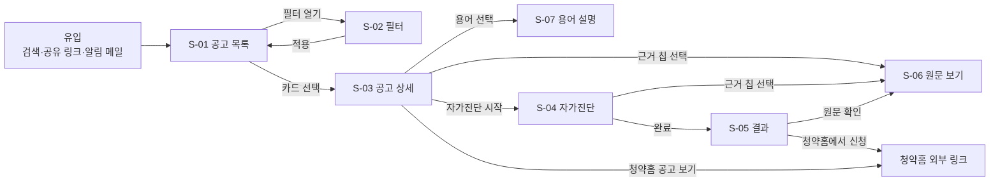
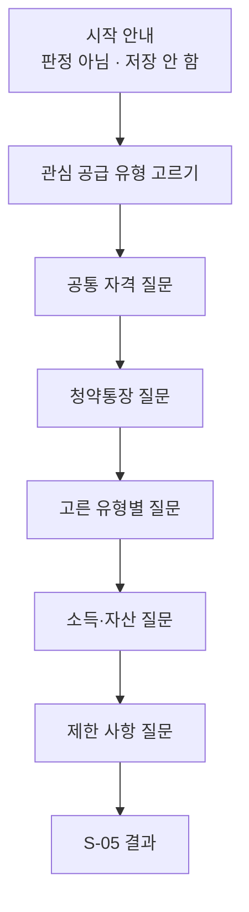

# 서비스 기획서: 청약 공고 요약·맞춤 탐색 서비스 "청담"

- 작성일: 2026-10-19
- 상태: 초안 (결정 사항 D-01~D-07 반영)
- 범위: MVP
- 관련 문서: [PRD](PRD.md), [MVP 일정](SCHEDULE.md)

> **이 문서의 역할**
> - PRD는 **무엇을, 왜** 만드는지 정한다. 이 문서는 PRD의 요구사항이 **화면에서 어떻게 보이고, 어떤 규칙으로 동작하는지** 정한다.
> - 개발·디자인·QA가 이 문서만 보고 화면을 만들고 검수할 수 있는 수준을 목표로 한다.
> - 요구사항 ID(F1-1 등)는 PRD를 따른다. 이 문서에서 새로 만드는 ID는 화면(S-), 정책(P-), 예외(E-), 이벤트(EV-), 결정 사항(D-)이다.
> - PRD와 내용이 다르면 PRD가 우선한다. 이 문서에서 PRD를 바꿔야 할 내용을 발견하면 [13장](#13-결정-사항)에 적고 PRD에 반영한다.

**목차**

1. [서비스 개요](#1-서비스-개요)
2. [사용자 시나리오](#2-사용자-시나리오)
3. [핵심 사용자 흐름](#3-핵심-사용자-흐름)
4. [정보 구조와 화면 목록](#4-정보-구조와-화면-목록)
5. [공통 정책](#5-공통-정책)
6. [화면 상세](#6-화면-상세)
   - [S-01 공고 목록](#s-01-공고-목록-홈)
   - [S-02 필터](#s-02-필터)
   - [S-03 공고 상세](#s-03-공고-상세)
   - [S-04 자가진단](#s-04-자가진단)
   - [S-05 자가진단 결과](#s-05-자가진단-결과)
   - [S-06 원문 보기](#s-06-원문-보기)
   - [S-07 용어 설명](#s-07-용어-설명)
   - [S-08 알림 구독·해지 (후순위)](#s-08-알림-구독해지-후순위)
   - [S-09 공통 화면](#s-09-공통-화면)
7. [데이터 정의 (화면 기준)](#7-데이터-정의-화면-기준)
8. [시스템 동작 정책](#8-시스템-동작-정책)
9. [예외 케이스](#9-예외-케이스)
10. [문구 가이드](#10-문구-가이드)
11. [측정 설계](#11-측정-설계)
12. [검수 시나리오](#12-검수-시나리오)
13. [결정 사항](#13-결정-사항)

---

## 1. 서비스 개요

### 1.1 한 줄 정의

> 청약을 처음 알아보는 사람이 **나와 관련 있는 APT 분양 공고를 찾고, 쉬운 말로 이해하고, 신청할 수 있을지 스스로 점검**하게 돕는 웹 서비스.

### 1.2 핵심 가치와 그것을 만드는 장치

| 사용자가 겪는 문제 (PRD 1장) | 서비스가 주는 가치 | 화면에서의 장치 |
|---|---|---|
| 발견: 새 공고를 계속 확인해야 한다 | 조건에 맞는 공고만 모아서 본다 | 공고 목록 + 필터(S-01, S-02), 알림(S-08, 후순위) |
| 이해: 공고문이 수십 쪽이고 용어가 어렵다 | 한 화면 요약 + 쉬운 용어 설명 | 공고 상세 요약·일정·주택형(S-03), 용어 설명(S-07) |
| 판단: 내가 신청할 수 있는지 모르겠다 | 질문에 답하며 스스로 점검한다 | 자가진단(S-04), 결과(S-05) |
| 신뢰: 요약이 맞는지 믿기 어렵다 | 모든 요약에 원문 근거가 붙는다 | 근거 칩 → 원문 해당 쪽(S-06) |

### 1.3 서비스가 하지 않는 것

- 자격을 판정하지 않는다. "신청 가능합니다", "자격이 있습니다" 같은 표현을 쓰지 않는다([10장](#10-문구-가이드)).
- 청약 신청을 대행하거나 청약홈 로그인을 받지 않는다. 신청은 청약홈에서 한다.
- 사용자 개인정보(프로필, 자가진단 응답)를 서버에 저장하지 않는다(P-09).

### 1.4 플랫폼

- **모바일 우선 반응형 웹.** 입문자는 출퇴근길에 휴대폰으로 공고를 훑어보는 경우가 많다고 가정한다(런칭 후 기기 비율로 검증, EV-01).
- 기준 화면 폭: 모바일 360px, 데스크톱 1280px. 768px 이상은 데스크톱 레이아웃.
- 지원 브라우저: 최신 Chrome, Safari(iOS 16+), Samsung Internet, Edge.

---

## 2. 사용자 시나리오

페르소나는 PRD 3장 "청약 입문자"를 구체화한 가상 인물이다.

### 2.1 페르소나 A: 사회초년생 "지원" (29세, 서울 거주, 미혼, 무주택)

- 청약통장은 부모님 권유로 5년 전에 만들어 두었지만 써 본 적이 없다.
- "생애최초"가 자기에게 해당하는지, 분양가가 얼마쯤인지 감이 없다.
- **시나리오:** 지인이 "요즘 서울 근처 분양 많다"고 해서 들어온다 → 지역 서울·경기, 접수 예정·접수 중으로 목록을 본다 → 생애최초 필터를 켜 본다 → 마음에 드는 단지 상세를 열어 분양가와 일정을 본다 → "생애최초" 용어를 눌러 뜻을 확인한다 → 자가진단으로 생애최초·일반공급 1순위를 점검한다 → "소득 기준 확인 필요"가 나와 원문 해당 쪽을 열어 소득 표를 직접 본다.

### 2.2 페르소나 B: 신혼부부 "하늘" (33세, 결혼 2년 차, 경기 거주, 맞벌이)

- 신혼부부 특별공급이 있다는 건 알지만 맞벌이 소득 기준이 헷갈린다.
- **시나리오:** 지역 경기, 특별공급 신혼부부, 전용 60~85㎡로 필터 → 결과가 0건이면 조건 완화 안내를 보고 분양가 상한을 넓힌다 → 공고 두세 개를 번갈아 열어 일정과 세대수를 비교한다 → 한 공고에서 자가진단을 끝까지 하고, 결과 화면에서 청약홈으로 이동한다.

### 2.3 시나리오에서 뽑은 기획 포인트

| 포인트 | 반영 위치 |
|---|---|
| 처음엔 "내 조건"이 아니라 "지역과 시기"로 넓게 본다 | 필터 기본값은 접수 예정 + 접수 중만 적용(P-01) |
| 필터를 바꿔 가며 여러 번 본다 → 조건이 사라지면 번거롭다 | 필터 상태를 URL에 남긴다(S-01, F3-11 이전의 임시 대안) |
| 결과 0건에서 이탈하기 쉽다 | 빈 결과에 조건 완화 제안(S-01 빈 상태) |
| 상세를 여러 개 번갈아 본다 | 상세 → 목록 복귀 시 스크롤 위치·필터 유지 |
| 숫자 기준(소득·기간)은 결국 원문을 봐야 한다 | 근거 칩 한 번으로 원문 해당 쪽 이동(S-06) |

---

## 3. 핵심 사용자 흐름

### 3.1 전체 흐름



### 3.2 1단계(찾기)와 2단계(점검)의 경계

- 1단계는 **여러 공고를 넓게** 보는 단계다. 사용자의 개인 사정을 묻지 않는다. 필터는 모두 공고의 속성(지역, 가격, 면적, 특별공급 유형)이다.
- 2단계는 **공고 하나를 깊게** 보는 단계다. 개인 사정을 예/아니오로 묻되 저장하지 않는다.
- 2단계로 넘어가는 입구는 공고 상세(S-03)의 "자가진단 시작" 버튼 하나다. 목록에서 바로 자가진단으로 가지 않는다(공고 내용을 보지 않고 점검하면 질문의 맥락을 이해하기 어렵다).

---

## 4. 정보 구조와 화면 목록

### 4.1 화면 목록

| ID | 화면 | URL | 우선순위 | 관련 요구사항 |
|---|---|---|---|---|
| S-01 | 공고 목록 (홈) | `/` | 필수 | F3-1~F3-10 |
| S-02 | 필터 | `/` 위 바텀시트(모바일) / 좌측 패널(데스크톱) | 필수 | F3-1~F3-9 |
| S-03 | 공고 상세 | `/notices/{공고번호}` | 필수 | F2-1~F2-6, F6-1 |
| S-04 | 자가진단 | `/notices/{공고번호}/check` | 중요 | F5-1, F5-2 |
| S-05 | 자가진단 결과 | `/notices/{공고번호}/check/result` | 중요 | F5-3 |
| S-06 | 원문 보기 | `/notices/{공고번호}/original?page={쪽}` | 필수 | F6-1, F6-2 |
| S-07 | 용어 설명 | 바텀시트·툴팁 / 전체 목록 `/glossary` | 필수 | F2-4 |
| S-08 | 알림 구독·해지 | `/alerts`, `/alerts/unsubscribe?token=…` | 후순위 | F3-11, F7-1~F7-4 |
| S-09 | 공통(404, 오류, 약관, 개인정보처리방침, 서비스 안내) | `/terms`, `/privacy`, `/about` | 필수 | PRD 6주차 |

- `{공고번호}`는 `HOUSE_MANAGE_NO`다. APT와 무순위·잔여세대가 번호 대역으로 겹치지 않으므로(PRD 7장) 하나의 경로를 쓴다.
- S-05 결과는 응답을 저장하지 않으므로 결과 URL을 직접 열거나 새로고침하면 S-04 처음으로 보낸다(P-09).

### 4.2 내비게이션

- 상단 바: 로고(→ S-01), 용어 사전(→ `/glossary`), 서비스 안내(→ `/about`). 알림이 런칭에 포함되면 "알림 받기"를 추가한다.
- 하단 푸터(모든 화면): 면책 문구(P-07), 데이터 출처, 이용약관, 개인정보처리방침, 문의 메일.
- 모바일에서는 하단 탭 바를 쓰지 않는다. 화면이 적고 흐름이 목록 → 상세로 단순하기 때문이다.

---

## 5. 공통 정책

### P-01. 접수 상태

PRD F3-4의 규칙을 화면 표시 기준으로 구체화한다.

**접수 기간 계산**

| 공고 유형 | 접수 시작일 | 접수 종료일 |
|---|---|---|
| 일반 분양 (APT API) | `SPSPLY_RCEPT_BGNDE`, 없으면 1순위 시작일 중 가장 이른 날(`GNRL_RNK1_*_BGNDE`: 해당지역·기타경기·기타지역) | 2순위 종료일 중 가장 늦은 날(`GNRL_RNK2_*_ENDDE`), 없으면 1순위 종료일 중 가장 늦은 날 |
| 무순위 | `SUBSCRPT_RCEPT_BGNDE` | `SUBSCRPT_RCEPT_ENDDE` |
| 불법행위 재공급 | `SPSPLY_RCEPT_BGNDE` 또는 `GNRL_RCEPT_BGNDE`가 있으면 그중 이른 날, 없으면 `SUBSCRPT_RCEPT_BGNDE` | `GNRL_RCEPT_ENDDE`가 있으면 그 날, 없으면 `SUBSCRPT_RCEPT_ENDDE` |

**상태 판정** (기준 시각은 한국 시간, 날짜 단위)

| 상태 | 조건 | 목록 배지 |
|---|---|---|
| 접수 예정 | 오늘 < 접수 시작일 | `접수 예정 D-3` (D-day는 시작일 기준) |
| 접수 중 | 접수 시작일 ≤ 오늘 ≤ 접수 종료일 | `접수 중 D-2` (D-day는 종료일 기준, 당일은 `오늘 마감`) |
| 마감 | 오늘 > 접수 종료일 | `마감` |
| 일정 미정 | 시작일·종료일을 모두 구할 수 없음 | `일정 확인 필요` (E-05) |

- 접수 시작일과 종료일 사이에 접수가 없는 날(예: 특별공급과 1순위 사이)도 "접수 중"으로 본다. 상세 화면의 일정 타임라인에서 오늘이 어느 단계인지 보여 준다(S-03).
- 상태는 저장하지 않고 조회 시점에 계산한다. 자정이 지나면 같은 공고의 상태가 바뀌어야 하므로, 목록 캐시는 한국 시간 자정에 무효화한다.

### P-02. 공고 유형 표시

| 유형 | 판별 (PRD F3-3) | 배지 |
|---|---|---|
| 일반 분양 | APT 오퍼레이션으로 수집 | 표시하지 않음 (기본값) |
| 무순위 | 무순위·잔여세대 API, `HOUSE_SECD_NM` = "무순위" | `무순위` |
| 불법행위 재공급 | 무순위·잔여세대 API, `HOUSE_SECD_NM` = "불법행위 재공급" | `재공급` |

- 주택 구분(민영/국민)은 일반 분양에만 있으므로 카드에서 단지명 옆 보조 텍스트로 표시한다. 무순위·잔여세대는 표시하지 않는다.

### P-03. 숫자·날짜 표기

| 항목 | 원본 | 표기 규칙 | 예 |
|---|---|---|---|
| 분양가 | `LTTOT_TOP_AMOUNT` 만원 단위 문자열 | 억·만 단위로 끊고 천 단위 쉼표, 1억 미만은 만 원 | `52340` → `5억 2,340만 원` |
| 분양가 범위(카드) | 주택형별 최고 분양가 | 최저~최고, 억 단위 소수 첫째 자리 | `3.2억 ~ 5.2억` |
| 전용면적 | `HOUSE_TY` 앞 숫자 | 소수 둘째 자리 반올림 + 타입 | `084.8860A` → `84.89㎡ A` |
| 전용면적 범위(카드) | | 정수, 같으면 하나만 | `59~84㎡` |
| 날짜 | `YYYY-MM-DD` | 올해면 연도 생략, 요일 표기 | `10.21(수)`, `2027.01.05(화)` |
| 입주 예정 | `MVN_PREARNGE_YM` | 연·월 | `203102` → `2031년 2월` |
| 세대수 | 정수 | 천 단위 쉼표 + 세대 | `1,204세대` |
| 값 없음 | `null`, 빈 문자열 | `-` 대신 이유를 쓴다 | `공고문 확인`, `해당 없음` |

- 평 환산은 표기하지 않는다. 평은 보통 공급면적 기준인데 무순위 공고에는 공급면적이 없어(PRD 7장) 공고마다 기준이 달라지기 때문이다.

### P-04. 정보가 없는 공고

- 무순위·잔여세대 공고에는 주택 구분, 특별공급 유형별 세대수, 규제 여부가 없다(PRD 7장).
- **필터:** 해당 필터를 고르면 그 공고는 결과에서 빠지고, 목록 상단에 안내 배너를 띄운다(PRD F3 "정보가 없는 공고").
  - 문구: `주택 구분·특별공급 정보가 없는 무순위·재공급 공고 12건은 제외했어요.` + `[포함해서 보기]`
  - `[포함해서 보기]`는 정보가 없는 필터(F3-2, F3-5)만 풀고 다른 조건은 유지한다.
- **상세:** 해당 항목을 숨기지 않고 `이 공고 유형은 청약홈에서 이 정보를 제공하지 않아요. 공고문에서 확인해 주세요.`로 표시한다. 항목이 아예 안 보이면 "없는 것"으로 오해할 수 있기 때문이다.

### P-05. 원문 근거 표시

PRD 4장 "모든 요약에 원문 근거 표시"와 8장 "근거 문자열 검증"을 화면 규칙으로 정한다.

**근거 칩**

- PDF에서 추출한 항목(자격 요건, 체크리스트 질문)마다 오른쪽에 근거 칩을 붙인다: `p.11`. 근거가 여러 쪽이면 `p.3 외 2`.
- API에서 온 항목(일정, 세대수, 분양가)에는 근거 칩 대신 섹션 단위로 `출처: 청약홈` 표기를 붙인다.
- 칩을 누르면 근거 미리보기를 띄운다(모바일 바텀시트, 데스크톱 팝오버).
  - 쪽 번호, 근거 문구(최대 300자, 넘으면 말줄임), `[원문에서 보기]` 버튼(→ S-06 해당 쪽).

**검증 상태별 표시**

| 상태 | 조건 (PRD 8장) | 화면 |
|---|---|---|
| 확인됨 | 근거 문구가 해당 쪽 원문에 문자열로 있음 | 항목과 근거 칩을 그대로 표시 |
| 확인 필요 | 근거 문구가 원문에서 확인되지 않거나 근거가 없음 | 항목을 회색으로 표시하고 `원문 확인 필요` 라벨. 자가진단 질문으로 쓰지 않는다(S-04) |
| 추출 실패 | 공고 전체 추출 실패 | 자격 요건 섹션 대신 실패 안내(P-06) |

- 문자열 매칭은 공백·줄바꿈·전각/반각 차이를 정규화한 뒤 비교한다. 1주차 실험에서 PDF 텍스트에 쪽 머리말("- 11 -")과 줄바꿈이 섞여 나왔다.
- "확인 필요" 비율이 공고의 30%를 넘으면 그 공고는 "추출 실패"로 취급한다(임계값은 4주차 품질 점검 후 조정).

### P-06. 공고 요약 준비 상태

공고는 API 수집 직후 기본 정보로 먼저 노출하고, PDF 추출이 끝나면 요약을 채운다. 노출 지연을 줄이기 위해서다(PRD 10장 첫 번째 지표).

| 상태 | 상세 화면의 자격 요건 섹션 | 자가진단 버튼 |
|---|---|---|
| 준비 중 (PDF 수집·추출 대기) | `공고문을 읽고 요약하고 있어요. 보통 몇 시간 안에 준비돼요.` + 원문 링크 | 비활성: `요약이 준비되면 진단할 수 있어요` |
| 완료 | 정상 표시 | 활성 |
| 일부 완료 (일부 분류만 추출) | 추출된 분류만 표시, 빠진 분류에 `이 내용은 공고문에서 확인해 주세요` | 활성. 빠진 분류는 결과에서 "확인 필요"로 처리 |
| 실패 (PDF 없음, 이미지 PDF, 추출 실패) | `이 공고는 자동 요약을 제공하지 못했어요. 공고문을 직접 확인해 주세요.` + 원문 링크 | 숨김 |

- 목록 카드에는 준비 상태를 표시하지 않는다. 목록의 정보는 모두 API 데이터라서 준비 상태와 상관없이 보여 줄 수 있다.

### P-07. 면책 안내

| 위치 | 형태 | 문구 |
|---|---|---|
| S-03 상세 상단 | 고정 배너(닫을 수 없음, 한 줄) | `요약은 공고문을 자동으로 정리한 참고 정보예요. 신청 전 반드시 공고문 원문을 확인하세요.` |
| S-04 자가진단 시작 화면 | 본문 안내 | `이 진단은 자격을 판정하지 않아요. 답한 내용은 저장되지 않아요.` |
| S-05 결과 상단 | 강조 박스 | `결과는 참고용이에요. 실제 자격은 공고문과 사업주체의 서류 심사로 정해져요.` |
| S-07 용어 설명 하단 | 보조 텍스트 | `일반적인 설명이에요. 공고마다 다를 수 있어요. 출처: 「주택공급에 관한 규칙」` |
| 모든 화면 푸터 | 보조 텍스트 | `청담은 청약홈(한국부동산원)의 공개 데이터와 공고문을 바탕으로 정보를 제공하며, 정보의 정확성을 보증하지 않습니다.` |

- PRD F2-5 "최종 확인은 원문으로"는 S-03 배너가 충족한다.

### P-08. 정정 공고

- 정정이 감지되면(PRD F1-5, 8장) 공고 버전을 하나 올리고, 무엇이 바뀌었는지 항목 단위로 기록한다(F1-6).
- **목록:** 정정 후 7일 동안 카드에 `정정` 배지를 붙인다.
- **상세:** 헤더에 `마지막 확인 10.19(월) 06:00 · 정정 1회` 표시(F2-6). `정정 1회`를 누르면 정정 이력 바텀시트를 연다.
  - 이력 항목: 감지 일시, 바뀐 항목, 이전 값 → 새 값. 예: `10.18 · 1순위 접수일 10.21 → 10.23`
  - PDF만 바뀐 경우(첨부파일 번호 변경, PRD 미해결 질문 1): `공고문이 새로 올라왔어요. 요약을 다시 만들었어요.`
- 정정 직후 재추출이 끝나기 전에는 이전 요약을 계속 보여 주되, 배너로 `공고가 정정되어 요약을 다시 만들고 있어요. 지금 보이는 요약은 정정 전 내용이에요.`를 띄운다.

### P-09. 개인정보

- MVP에서는 회원가입, 로그인, 프로필이 없다(PRD 5장).
- 자가진단 응답은 **브라우저 메모리에만** 둔다. 서버로 보내지 않고, `localStorage`·`sessionStorage`에도 쓰지 않는다.
  - 결과 화면을 새로고침하면 응답이 사라지므로 S-04 처음으로 돌아가고 `답한 내용은 저장되지 않아 다시 진단해야 해요.`를 띄운다.
  - 진단 중 다른 화면으로 나가려 하면 확인 창을 띄운다: `나가면 답한 내용이 사라져요.`
- 분석 이벤트에 응답 값을 넣지 않는다. 몇 번째 질문까지 갔는지 같은 진행 정보만 보낸다(11장).
  - 예외: 질문 개선을 위한 **답 횟수 익명 집계**(EV-11). 사용자·세션과 연결하지 않고 질문 ID별 선택지 횟수만 남긴다. 개인정보처리방침에 명시한다. (D-05)
- 알림 구독(후순위)에서 받는 개인정보는 이메일 주소 하나다. 개인정보처리방침에 수집 항목·목적·보관 기간·파기 방법을 쓴다.

---

## 6. 화면 상세

각 화면은 목적, 진입 경로, 구성, 동작, 빈 상태·예외 순으로 쓴다. 와이어프레임은 배치를 보여 주기 위한 것이며 디자인 시안이 아니다.

### S-01 공고 목록 (홈)

**목적:** 조건에 맞는 공고를 빠르게 훑고 상세로 들어간다. (1단계: 찾기)

**진입:** 첫 방문, 로고, 상세에서 뒤로 가기, 공유 링크(필터가 담긴 URL), 알림 메일.

**와이어프레임 (모바일)**

```
┌────────────────────────────────┐
│ 청담              용어사전  안내 │
├────────────────────────────────┤
│ 🔍 단지명 검색                   │
│ [필터 3] [서울✕][경기✕][접수중✕] │  ← 적용된 조건 칩, 가로 스크롤
│ 공고 24건        접수 임박순 ▾   │
├────────────────────────────────┤
│ ⓘ 정보가 없는 무순위·재공급 공고  │
│   5건은 제외했어요 [포함해서 보기] │
├────────────────────────────────┤
│ [접수 중 D-2] [정정]             │
│ ○○자이 더 센트럴        민영     │
│ 경기 수원시 장안구               │
│ 3.2억 ~ 5.2억 · 59~84㎡ · 812세대│
│ 특공 10.20(화) → 2순위 10.23(금) │
│ #신혼부부 #생애최초 #다자녀 +2   │
├────────────────────────────────┤
│ [접수 예정 D-5] [무순위]         │
│ ...                            │
├────────────────────────────────┤
│           [ 더 보기 ]           │
└────────────────────────────────┘
```

**구성 요소**

| 영역 | 요소 | 표시 데이터·규칙 | 요구사항 |
|---|---|---|---|
| 검색 | 단지명 검색창 | `HOUSE_NM` 부분 일치. 입력 후 300ms 디바운스 또는 엔터로 검색. 공백·괄호 표기("(조합원 취소분)")를 무시하고 비교 | F3-8 |
| 필터 바 | `필터 N` 버튼 | 기본값과 다른 조건 개수. 누르면 S-02 | F3-1~7 |
| | 적용 조건 칩 | 조건 값마다 칩 하나, `✕`로 개별 해제. 지역 3개 이상이면 `서울 외 2` | |
| 결과 | 결과 수 | `공고 N건` | |
| | 정렬 | `접수 임박순`(기본) / `최신 공고순` | F3-10 |
| | 제외 안내 배너 | P-04 | F3 |
| 카드 | 배지 | 접수 상태(P-01) → 공고 유형(P-02) → 정정(P-08) 순 | |
| | 단지명 + 주택 구분 | `HOUSE_NM` 두 줄 넘으면 말줄임, `HOUSE_DTL_SECD_NM` | F2-1 |
| | 위치 | `SUBSCRPT_AREA_CODE_NM` + `HSSPLY_ADRES`의 시·군·구까지 | F2-1 |
| | 핵심 숫자 | 분양가 범위 · 전용면적 범위 · 총 세대수(P-03) | F2-1 |
| | 일정 요약 | 접수 예정·중: 첫 접수일 → 마지막 접수일. 마감: `당첨자 발표 10.30(금)` | F2-1 |
| | 특별공급 태그 | 세대수 1 이상인 유형만, 세대수 많은 순 최대 3개 + `+N`. 필터에서 고른 유형은 강조색 | F3-5 |

**정렬 규칙 (F3-10)**

- **접수 임박순(기본):** 접수 중(종료일 가까운 순) → 접수 예정(시작일 가까운 순) → 일정 확인 필요 → 마감(종료일 최근 순).
  - 접수 시작일 순으로만 정렬하면 이미 접수 중인 공고가 맨 뒤로 밀리므로, 접수 중을 먼저 두고 마감일 순으로 정렬한다. (D-01, PRD F3-10 반영)
- **최신 공고순:** `RCRIT_PBLANC_DE` 내림차순, 같으면 공고번호 내림차순.

**동작**

- 한 번에 20건을 보여 주고 `더 보기`로 20건씩 더 불러온다. 무한 스크롤을 쓰지 않는 이유: 푸터의 면책·출처에 닿을 수 있어야 하고, 상세에서 돌아왔을 때 위치 복원이 쉽다.
- 필터·검색어·정렬 상태를 URL 쿼리에 남긴다. 예: `/?region=서울,경기&status=upcoming,open&supply=newlywed&sort=deadline`
  - 공유·북마크로 같은 목록을 다시 볼 수 있다. F3-11(조건 저장, 후순위)이 빠지더라도 이 방식으로 최소한의 "조건 다시 보기"를 제공한다.
- 상세에서 뒤로 오면 스크롤 위치와 불러온 개수(더 보기 횟수)를 복원한다.
- 마감 공고는 접수 종료일로부터 1년 이내인 것만 보여 준다. 작년 같은 지역·단지 공고를 참고하기에 충분한 기간이다. (D-02)

**빈 상태·예외**

| 상황 | 화면 |
|---|---|
| 결과 0건 | `조건에 맞는 공고가 없어요.` + 결과가 생기는 완화 제안 버튼 최대 2개. 예: `[마감 공고도 보기 (8건)]`, `[분양가 조건 빼기 (3건)]`. 제안은 조건을 하나씩 뺐을 때의 건수로 계산해 건수가 많은 순 |
| 검색어 결과 0건 | `'○○' 단지를 찾지 못했어요. 필터 조건 안에서만 찾았어요.` + `[필터 풀고 검색]` |
| 목록 API 오류 | `공고를 불러오지 못했어요.` + `[다시 시도]` |
| 마지막 수집이 24시간 넘게 실패 | 결과 수 옆에 `마지막 업데이트 10.18(일) 06:00` 경고색 표시 (E-10) |

### S-02 필터

**목적:** 공고 속성으로 목록을 좁힌다.

**형태:** 모바일은 전체 높이 바텀시트, 하단에 `초기화` / `공고 N건 보기` 버튼. 데스크톱은 목록 왼쪽 고정 패널, 바꿀 때마다 즉시 적용.

- 모바일에서는 조건을 바꿀 때마다 `공고 N건 보기`의 N을 갱신한다. 0건이 되는 조합을 적용 전에 알 수 있게 하기 위해서다.

**필터 사양**

| 순서 | 필터 | 컨트롤 | 값 | 기본값 | 요구사항 |
|---|---|---|---|---|---|
| 1 | 접수 상태 | 칩 다중 선택 | 접수 예정 / 접수 중 / 마감 | 접수 예정 + 접수 중 | F3-4 |
| 2 | 지역 | 칩 다중 선택 | 시·도 17개(서울, 부산, 대구, 인천, 광주, 대전, 울산, 세종, 경기, 강원, 충북, 충남, 전북, 전남, 경북, 경남, 제주). 수도권 묶음 칩(서울·경기·인천) 별도 제공 | 전체 | F3-1 |
| 3 | 특별공급 유형 | 칩 다중 선택, 칩마다 `?`(S-07) | 신혼부부, 생애최초, 다자녀, 신생아, 노부모부양, 청년, 기관추천 | 선택 안 함 | F3-5 |
| 4 | 분양가 | 최소·최대 드롭다운 | 1억 단위 0~15억, `15억 이상` | 제한 없음 | F3-6 |
| 5 | 전용면적 | 칩 다중 선택 | 60㎡ 이하 / 60~85㎡ / 85㎡ 초과 | 선택 안 함 | F3-7 |
| 6 | 공고 유형 | 칩 다중 선택 | 일반 분양 / 무순위 / 불법행위 재공급 | 전체 | F3-3 |
| 7 | 주택 구분 | 칩 다중 선택 | 민영 / 국민 | 전체 | F3-2 |

- 순서는 입문자가 많이 쓸 것으로 예상하는 순이다. 런칭 후 필터 사용 이벤트(EV-03)를 보고 조정한다.
- 전용면적 구간은 60㎡·85㎡ 기준이다. 국민주택규모(85㎡)와 대부분의 공고에서 주택형이 갈리는 기준이라 입문자에게도 "59, 84"로 익숙하다.
  - 구간 경계: `60㎡ 이하` = 전용 ≤ 60, `60~85㎡` = 60 < 전용 ≤ 85, `85㎡ 초과` = 전용 > 85.
- 특별공급 유형 아래에 보조 문구: `무순위·재공급 공고는 특별공급 정보가 없어 제외돼요.`

**조건 결합 (F3-9)**

- 서로 다른 필터는 AND, 한 필터 안의 여러 값은 OR.
- 주택형 단위 필터(특별공급 유형, 분양가, 전용면적)는 **한 주택형이 모두 만족**해야 그 공고가 나온다.
  - 예: 신혼부부 + 분양가 5억 이하 + 60~85㎡ → "전용 84㎡ 이면서 최고 분양가 5억 이하이면서 신혼부부 세대수가 1 이상"인 주택형이 하나라도 있는 공고.
  - 59㎡는 4억에 신혼부부 0세대, 84㎡는 6억에 신혼부부 20세대인 공고는 나오지 않는다.
- 상세 화면의 주택형 표에서 필터 조건을 만족하는 주택형을 강조해, 왜 이 공고가 나왔는지 보이게 한다(S-03).

### S-03 공고 상세

**목적:** 공고 하나의 핵심을 한 화면에서 이해하고, 자가진단이나 원문으로 넘어간다.

**진입:** S-01 카드, 공유 링크, 알림 메일.

**와이어프레임 (모바일)**

```
┌────────────────────────────────┐
│ ←                         공유  │
│ ⚠ 요약은 참고 정보예요. 신청 전   │
│   반드시 공고문 원문을 확인하세요. │
├────────────────────────────────┤
│ [접수 중 D-2] [정정]             │
│ ○○자이 더 센트럴                 │
│ 민영 · 경기 수원시 장안구 ○○동    │
│ 마지막 확인 10.19 06:00 · 정정 1회│
├── [요약] [일정] [주택형] [자격요건] ┤ ← 섹션 앵커 탭, 스크롤 시 상단 고정
│ ■ 핵심 요약          출처: 청약홈 │
│  총 812세대 (특공 402 · 일반 410)│
│  분양가 3억 2,100만 ~ 5억 2,340만│
│  입주 예정 2029년 3월            │
│  투기과열지구 ?                  │
├────────────────────────────────┤
│ ■ 일정                          │
│  ● 특별공급   10.20(화)   완료   │
│  ◉ 1순위      10.21~22   오늘   │
│  ○ 2순위      10.23(금)          │
│  ○ 당첨 발표  10.30(금)          │
│  ○ 계약      11.10~12           │
├────────────────────────────────┤
│ ■ 주택형별 공급                  │
│  59A  59.97㎡  3.2억  특공 120…  │
│  84A★ 84.89㎡  5.2억  특공 180…  │ ← ★ 필터 조건 만족
├────────────────────────────────┤
│ ■ 자격 요건 (공고문 요약)         │
│  ▸ 공통 자격               (5)  │
│  ▸ 청약통장                (3)  │
│  ...                           │
├────────────────────────────────┤
│ [공고문 원문]  [청약홈에서 보기 ↗] │
├────────────────────────────────┤
│ [   내 상황으로 자가진단 해보기   ]│ ← 하단 고정 CTA
└────────────────────────────────┘
```

**구성 요소**

| 섹션 | 요소 | 표시 데이터·규칙 | 요구사항 |
|---|---|---|---|
| 상단 | 면책 배너 | P-07 | F2-5 |
| | 공유 | 모바일은 OS 공유 시트, 데스크톱은 링크 복사 + `링크를 복사했어요` 토스트 | |
| 헤더 | 배지, 단지명, 주택 구분, 주소 | S-01 카드와 같음. 주소는 `HSSPLY_ADRES` 전체 | F2-1 |
| | 마지막 확인 시각·정정 이력 | P-08 | F2-6 |
| 핵심 요약 | 총 세대수 | `TOT_SUPLY_HSHLDCO` + (특별공급 합 · 일반공급 합) | F2-1 |
| | 분양가 | 주택형별 최고 분양가의 최저~최고(P-03) | F2-1 |
| | 입주 예정 | `MVN_PREARNGE_YM` | F2-1 |
| | 규제 지역 | 투기과열지구·조정대상지역·분양가상한제 해당 시 칩, 각 칩에 `?`(S-07). 해당 없으면 `규제 지역 아님` | F2-1 |
| 일정 | 타임라인 | 특별공급 → 1순위 → 2순위 → 당첨자 발표 → 계약. 값 없는 단계는 생략. 오늘 단계 강조, 지난 단계 `완료` | F2-1 |
| | 지역별 1·2순위 | 해당지역/기타경기/기타지역 날짜가 다르면 단계를 펼쳐서 지역별로 표시 | F2-1 |
| 주택형 | 표 | 주택형, 전용면적, 최고 분양가, 일반공급 세대수, 특별공급 세대수. 행을 누르면 특별공급 유형별 세대수 펼침 | F1-2, F2-1 |
| | 필터 일치 표시 | 목록 필터 조건(F3-5~7)을 모두 만족하는 행에 강조 | F3-9 |
| 자격 요건 | 분류별 아코디언 | 7.2의 6개 분류, 분류 제목에 항목 수. 첫 진입 시 "공통 자격"만 펼침 | F2-2 |
| | 요건 항목 | `[대상]` 라벨 + 쉬운 문장 + 근거 칩(P-05). 대상은 칩 형태(`전체`, `신혼부부 특공` 등) | F2-2, F2-3 |
| | 용어 링크 | 문장 안의 사전 용어(7.4)에 점선 밑줄, 누르면 S-07 | F2-4 |
| 원문 | 버튼 2개 | `공고문 원문`(→ S-06), `청약홈에서 보기 ↗`(`PBLANC_URL`, 새 탭) | F6-1 |
| 하단 고정 | 자가진단 CTA | P-06 상태에 따름. 마감 공고에서는 `지난 공고로 자가진단 연습하기`로 문구 변경 | F5 |

**무순위·재공급 공고의 차이**

- 일정은 접수 기간 한 단계와 당첨자 발표·계약만 표시한다.
- 핵심 요약의 규제 지역, 주택형 표의 특별공급 유형별 세대수는 P-04 문구로 대체한다.
- 무순위 공고는 대개 "청약통장 불필요, 무주택세대구성원"처럼 요건이 단순하다(1주차 추출 결과). 자격 요건 섹션은 같은 구조를 쓰되 "해당 없음" 분류는 접어서 맨 아래로 보낸다.

**규제 지역 표시 조건**

- PRD 7장에서 규제 필드(`SPECLT_RDN_EARTH_AT` 등)의 의미는 "의미 추정" 상태다. **오퍼레이션 명세로 의미를 확인하기 전에는 규제 지역 칩을 노출하지 않는다.** 잘못된 규제 정보는 전매·재당첨 판단을 틀리게 만든다. 명세 확인은 3주차 전에 담당 A가 한다. (D-03)

### S-04 자가진단

**목적:** 고른 공고의 자격 요건을 질문에 답하며 스스로 점검한다. (2단계: 점검)

**진입:** S-03 하단 CTA만. P-06이 "완료" 또는 "일부 완료"일 때만 활성.

**흐름**



**단계 0: 시작 안내**

- 문구: `○○자이 더 센트럴 공고의 신청 조건을 질문으로 정리했어요. 질문 N개, 약 M분 걸려요.` + P-07 안내.
- N은 단계 1에서 고른 유형에 따라 바뀌므로 "최대 N개"로 표시한다.

**단계 1: 관심 공급 유형 고르기**

- 이 공고에 있는 공급 유형만 보여 준다(세대수 1 이상인 특별공급 유형 + 일반공급 1순위·2순위, 무순위 공고는 "무순위" 하나).
- 다중 선택. `잘 모르겠어요`를 고르면 모든 유형을 점검한다(질문 수가 늘어난다는 안내 표시).
- 유형마다 `?`로 S-07 설명.
- 고르지 않은 유형의 질문은 묻지 않는다. 질문 수를 줄여 완료율을 높이기 위해서다(PRD 10장 자가진단 완료율).

**단계 2~6: 질문**

```
┌────────────────────────────────┐
│ ✕                       3 / 12 │
│ ━━━━━━━━━░░░░░░░░░░░░░░░░░░░░░ │
│ 공통 자격                        │
│                                │
│ 입주자모집공고일(2026.09.23)     │
│ 현재 세대 구성원 모두가 주택을    │
│ 갖고 있지 않나요?                │
│                                │
│ ⓘ 분양권·입주권도 주택으로 봐요.  │
│   60세 이상 부모님 소유 주택 등   │
│   예외가 있어요. 근거 p.14 ›     │
│                                │
│ [ 예 ]                          │
│ [ 아니오 ]                      │
│ [ 잘 모르겠어요 ]                │
│                                │
│ ‹ 이전                          │
└────────────────────────────────┘
```

| 요소 | 규칙 | 요구사항 |
|---|---|---|
| 진행 표시 | `현재 / 전체`, 진행 막대. 단계(분류) 이름을 위에 표시 | |
| 질문 | 한 화면에 하나. 질문 데이터 규칙은 7.3 | F5-1 |
| 도움말 | 예외·용어 설명 한두 줄 + 근거 칩 | F5-2 |
| 답 | `예` / `아니오` / `잘 모르겠어요`. 누르면 바로 다음 질문(별도 다음 버튼 없음) | F5-1 |
| 이전 | 이전 질문으로, 답 유지 | |
| 닫기 `✕` | 확인 창(P-09) 후 S-03 | |

- **중간에 끊지 않는다.** 공통 자격에 `아니오`라고 답해도 진단을 멈추지 않는다. 서비스는 판정하지 않으므로, 어떤 답이 결과에 어떻게 반영됐는지 결과 화면에서 보여 주는 것으로 충분하다. 단, 공통 자격 `아니오` 직후 한 줄 안내를 띄운다: `이 조건은 대부분의 공급 유형에 필요해요. 계속 진행해서 다른 조건도 확인해 볼 수 있어요.`
- **소득·자산 질문은 금액을 묻지 않는다.** 공고문의 기준 표(가구원 수별 월평균소득 기준 금액)를 질문 안에 그대로 보여 주고 `우리 가구 월평균소득이 표의 ○○% 금액 이하인가요?`로 묻는다. 사용자가 금액을 입력하지 않으므로 민감 정보를 다루지 않고, 서비스가 계산·판정하지도 않는다.
- "원문 확인 필요"(P-05) 항목은 질문으로 만들지 않고, 해당 단계 끝에 `이 단계에는 자동으로 정리하지 못한 조건이 있어요. 원문 p.12를 확인해 주세요.` 카드로 보여 준다.

### S-05 자가진단 결과

**목적:** 답에 따라 검토해 볼 만한 공급 유형을 정리하고, 다음 행동(원문 확인, 청약홈)으로 잇는다. (F5-3)

**결과 분류 규칙**

공급 유형 U마다, U에 적용되는 질문(공통 + U가 요구하는 청약통장·소득·제한 질문 + U 고유 질문)의 답을 모아 분류한다.

| 분류 | 조건 | 표시 |
|---|---|---|
| 검토해 볼 만한 유형 | 모든 답이 `예`, 그리고 U에 "원문 확인 필요" 항목 없음 | 초록 |
| 확인이 더 필요한 유형 | `아니오` 없음, 그리고 (`잘 모르겠어요` 1개 이상 또는 "원문 확인 필요" 항목 있음) | 노랑 |
| 조건이 맞지 않을 수 있는 유형 | `아니오` 1개 이상 | 회색 |

- "자격 있음/없음", "신청 가능/불가"라는 말을 쓰지 않는다(10장).
- 유형 카드를 펼치면 그 분류가 된 이유를 질문 단위로 보여 준다. 예: `아니오: 혼인 기간이 7년 이내인가요? (근거 p.8)`. 사용자가 답을 고쳐 보고 싶으면 `이 질문 다시 답하기`로 S-04의 해당 질문으로 가서 답을 바꾸고 결과로 돌아온다.

**와이어프레임 (모바일)**

```
┌────────────────────────────────┐
│ ⚠ 결과는 참고용이에요. 실제 자격은 │
│   공고문과 서류 심사로 정해져요.  │
├────────────────────────────────┤
│ 검토해 볼 만한 유형               │
│ ▸ 일반공급 1순위                 │
├────────────────────────────────┤
│ 확인이 더 필요한 유형             │
│ ▸ 생애최초 특별공급               │
│   잘 모르겠어요: 소득 기준 (p.12) │
├────────────────────────────────┤
│ 조건이 맞지 않을 수 있는 유형      │
│ ▸ 신혼부부 특별공급               │
├────────────────────────────────┤
│ 접수 일정  1순위 10.21(수)        │
│ [공고문 원문]  [청약홈에서 신청 ↗] │
│ [다시 진단하기]  [공고로 돌아가기] │
└────────────────────────────────┘
```

- 결과 아래에 검토해 볼 만한 유형과 확인이 더 필요한 유형의 접수 일정을 보여 준다(공고가 접수 예정·중일 때).
- `청약홈에서 신청 ↗`는 청약홈 메인으로 보낸다. 청약홈의 신청 화면 딥링크는 로그인이 필요해 쓰지 않는다.
- 결과를 이미지·링크로 공유하는 기능은 MVP에서 제공하지 않는다(응답이 담긴 결과가 남는 것을 피하기 위해).

### S-06 원문 보기

**목적:** 근거 칩에서 원문 해당 쪽을 바로 확인한다. (F6-1, F6-2)

- **형태:** 서비스 안의 PDF 뷰어. 모바일은 전체 화면, 데스크톱은 상세 오른쪽 분할 패널(상세를 보면서 원문을 함께 본다).
- **진입 시 동작:** `?page=` 쪽으로 이동하고, 근거 문구를 텍스트 레이어에서 찾아 형광펜으로 강조한다. 문구를 못 찾으면(이미지 쪽 등) 쪽 이동만 하고 상단에 `근거 문구: "…"`를 띄운다.
- **도구:** 쪽 이동(이전/다음, 쪽 번호 입력), 확대·축소, 원본 PDF 내려받기, `청약홈에서 보기 ↗`.
- **원본 출처 표기:** 뷰어 상단에 `출처: 청약홈 입주자모집공고문 · 수집 10.17(토)`.
- **대체 경로:** 뷰어를 띄울 수 없는 환경(구형 브라우저, 뷰어 로드 실패)에서는 PDF를 새 탭으로 열고 `#page=N`을 붙인다.
- **기본안은 자체 뷰어**로 한다. 서비스가 저장한 PDF 사본을 보여 주는 것이 청약홈·공공데이터 이용 조건에 맞는지 3주차 전에 확인한다.
- **대안:** 이용 조건상 안 되면 원문 보기는 청약홈 링크로만 제공하고, 근거 칩은 쪽 번호와 문구 미리보기까지만 제공한다. 이 경우 F6-2 "해당 쪽으로 이동"은 충족하지 못하므로 PRD를 함께 고친다. (D-04)

### S-07 용어 설명

**목적:** 어려운 청약 용어를 그 자리에서 이해한다. (F2-4)

- **형태:** 모바일 바텀시트, 데스크톱 툴팁(클릭 시 고정). 전체 목록은 `/glossary`(가나다순, 검색 가능).
- **구성:** 용어, 한 줄 설명(40자 안팎), 조금 더 자세히(3~5줄), 출처 법령, P-07 문구.
- **노출 위치:** 필터 칩의 `?`, 상세 본문의 점선 밑줄 용어, 자가진단 유형 선택·도움말.
- 한 화면에서 같은 용어는 처음 나올 때만 밑줄을 친다(밑줄이 너무 많으면 읽기 어렵다).
- 초기 용어 목록과 설명 초안은 7.4. **설명은 런칭 전에 법령 원문과 대조해 검수한다.** 일반 설명이라 공고 원문 근거 대신 법령 출처를 단다.

### S-08 알림 구독·해지 (후순위)

PRD에서 후순위이며 미해결 질문 5(회원가입 없이 이메일 구독)에 달려 있다. 아래는 "이메일만으로 구독"을 택했을 때의 안이다.

- **구독:** S-01 결과 수 옆 `이 조건으로 알림 받기` → 현재 필터 요약 확인 + 이메일 입력 + 개인정보 수집 동의(필수) → 확인 메일 발송 → 메일의 링크를 누르면 구독 확정(더블 옵트인).
  - 더블 옵트인을 쓰는 이유: 남의 이메일로 구독하는 것을 막고, 스팸 처리율을 낮춘다.
- **발송:** 하루 한 번 아침 묶음 발송. 조건에 맞는 신규 공고가 없으면 보내지 않는다(F7-2). 관심 공고 정정 알림은 "바뀐 항목 이전 값 → 새 값"을 담는다(F7-3).
- **해지:** 모든 메일 하단에 `알림 그만 받기`. 한 번 누르면 바로 해지되고 확인 화면을 보여 준다(로그인·추가 입력 없음, F7-4).
- 구독 개수 제한: 이메일 하나당 조건 3개.

### S-09 공통 화면

| 화면 | 내용 |
|---|---|
| 404 | `찾는 페이지가 없어요.` + `[공고 목록으로]`. API에서 사라진 공고는 E-08 |
| 오류 | `잠시 문제가 생겼어요.` + `[다시 시도]` |
| 서비스 안내 `/about` | 서비스가 하는 것·하지 않는 것(1.3), 데이터 출처, 업데이트 주기, 자동 요약의 한계 |
| 이용약관·개인정보처리방침 | 6주차 준비 항목(SCHEDULE). 자가진단 응답을 저장하지 않는다는 점을 개인정보처리방침에 명시 |

---

## 7. 데이터 정의 (화면 기준)

API 필드 원천은 PRD 7장을 따른다. 여기서는 화면에 필요한 **가공 필드**와 **추출 결과 구조**를 정한다. 1주차에 확정하기로 한 "DB 스키마, 추출 결과 JSON 스키마"(SCHEDULE)의 기획 쪽 입력이다.

### 7.1 공고·주택형 가공 필드

| 필드 | 만드는 규칙 | 쓰는 곳 |
|---|---|---|
| 공고 유형 | P-02 | S-01, S-02, S-03 |
| 접수 시작일·종료일 | P-01 | 상태, 정렬, 카드 일정 |
| 전용면적(숫자) | `HOUSE_TY` 앞뒤 공백 제거 후 숫자 부분 | 필터, 표기 |
| 최고 분양가(숫자, 만원) | `LTTOT_TOP_AMOUNT` 숫자 변환. 0이나 빈 값은 `null`(E-06) | 필터, 표기 |
| 분양가 범위 | 주택형 최고 분양가의 min~max (`null` 제외) | 카드, 요약 |
| 전용면적 범위 | 주택형 전용면적 min~max | 카드 |
| 특별공급 유형 목록 | 유형별 세대수 합이 1 이상인 유형, 세대수 내림차순 | 카드 태그, 자가진단 단계 1 |
| 요약 준비 상태 | P-06의 4개 값 | 상세, 자가진단 |
| 버전, 정정 이력 | P-08 | 상세 |
| 마지막 확인 시각 | 그 공고를 API로 마지막에 다시 조회한 시각 | 상세 |

### 7.2 자격 요건 추출 결과

1주차 실험(`experiments/pdf_extraction/extract.py`)의 분류와 줄 형식을 이어받는다.

| 필드 | 설명 | 예 |
|---|---|---|
| 분류 | 1 공통 자격 / 2 청약통장 / 3 일반공급 순위 / 4 특별공급 유형별 / 5 소득·자산 / 6 제한 사항 | `1` |
| 대상 | 적용되는 공급 유형 목록. `전체` 또는 7.3의 공급 유형 코드 | `["newlywed"]` |
| 요건 문장 | 80자 안팎의 쉬운 문장. 숫자·기간·비율은 원문 그대로 | `혼인 기간 7년 이내여야 해요` |
| 근거 | `[{쪽, 문구, 검증 결과}]` 1개 이상 | `[{11, "…", true}]` |
| 상태 | 확인됨 / 확인 필요 (P-05) | |

- 1주차 결과에서 「주택공급에 관한 규칙」의 일반 정의(세대의 정의, 무주택으로 보는 예외 등)가 항목 수십 개로 나열되는 문제가 있었다. 상세 화면에서는 이런 항목을 **"일반 규정" 묶음으로 접어서** 분류 맨 아래에 두고, 이 공고에만 해당하는 조건(거주 지역, 판단 기준일, 소득 비율, 재당첨 제한 기간)을 위에 둔다. 추출 단계에서 `일반 규정 여부` 플래그를 함께 받는다.

### 7.3 자가진단 질문

| 필드 | 설명 |
|---|---|
| 질문 ID | 공고 버전 안에서 고유 |
| 연결 요건 | 7.2 요건 1개 이상 (근거는 요건의 근거를 쓴다) |
| 단계 | 7.2 분류와 같음 |
| 적용 공급 유형 | 이 질문이 영향을 주는 유형 목록 (결과 분류 계산에 씀) |
| 질문 문장 | `~인가요?` 형태, "예"가 요건 충족이 되도록 쓴다 |
| 도움말 | 예외·용어 1~2줄 (선택) |
| 기준 표 | 소득·자산 질문의 기준 금액 표 (선택) |

**생성 방식 (D-06):** LLM이 아래 작성 규칙에 따라 요건을 질문으로 바꾸고, 코드로 다음을 검증한다: 연결 요건이 있고 그 요건이 "확인됨" 상태인지, 질문 수 상한, 적용 공급 유형이 이 공고에 있는 유형인지. 검증에 실패한 질문은 쓰지 않고 해당 요건을 "원문 확인 필요" 카드로 보낸다(S-04). 4주차 품질 점검에서 규칙 기반 템플릿으로 바꿀지 다시 판단한다.

**질문 작성 규칙 (추출·변환 담당 A와 합의 필요)**

- 요건 하나에 질문 하나가 기본이다. 같은 대상에 대한 비슷한 요건은 질문 하나로 합칠 수 있다(예: 거주 지역 + 거주 기간).
- "예"가 항상 요건을 충족하는 방향이 되게 쓴다. 부정 질문(`~하지 않나요?`)은 무주택처럼 원래 부정형인 요건에만 쓴다.
- 날짜 기준이 있으면 질문에 구체적 날짜를 넣는다: `입주자모집공고일(2026.09.23) 현재`.
- 일반 규정(7.2)은 질문으로 만들지 않고 관련 질문의 도움말로 넣는다.
- 공고 하나의 질문 수는 유형을 모두 골랐을 때 20개 이하를 목표로 한다.

**공급 유형 코드**

`general_1st`(일반 1순위), `general_2nd`(일반 2순위), `newlywed`(신혼부부), `first_home`(생애최초), `multi_child`(다자녀), `newborn`(신생아), `elderly_parent`(노부모부양), `youth`(청년), `institution`(기관추천), `no_rank`(무순위), `resupply`(불법행위 재공급)

### 7.4 용어 사전 초기 목록 (설명 초안, 법령 검수 전)

| 용어 | 한 줄 설명 (초안) |
|---|---|
| 특별공급 | 신혼부부·다자녀 등 정책적으로 배려가 필요한 사람에게 일반공급과 따로 먼저 공급하는 물량 |
| 일반공급 | 특별공급을 뺀 나머지 물량. 1순위·2순위 순서로 접수 |
| 1순위 / 2순위 | 청약통장 가입 기간·납입 횟수 등 조건에 따라 나뉘는 신청 순서. 1순위가 먼저 접수 |
| 해당지역 우선 | 공급 지역에 일정 기간 이상 산 사람에게 먼저 공급하는 것 |
| 무주택세대구성원 | 세대주와 세대원 모두 주택을 갖고 있지 않은 세대의 구성원 |
| 세대주 | 주민등록상 세대를 대표하는 사람 |
| 청약통장 | 아파트 청약에 필요한 저축 통장. 현재는 주택청약종합저축 |
| 신혼부부 특별공급 | 혼인 기간 7년 이내 무주택 부부 등을 위한 특별공급 |
| 생애최초 특별공급 | 세대 구성원 모두 주택을 가져 본 적이 없는 사람을 위한 특별공급 |
| 다자녀 특별공급 | 미성년 자녀가 여러 명인 가구를 위한 특별공급 |
| 신생아 특별공급 | 일정 기간 안에 출산·입양한 자녀가 있는 가구를 위한 특별공급 |
| 노부모부양 특별공급 | 만 65세 이상 직계존속을 일정 기간 이상 모신 사람을 위한 특별공급 |
| 청년 특별공급 | 일정 연령대 미혼 청년을 위한 특별공급 (주로 공공분양) |
| 기관추천 특별공급 | 국가유공자·장애인 등 관계 기관이 추천한 사람을 위한 특별공급 |
| 민영주택 / 국민주택 | 민간이 짓는 주택 / 국가·지자체·LH 등이 짓거나 주택도시기금 지원을 받는 주택. 신청 조건이 다름 |
| 전용면적 / 공급면적 | 집 안에서 혼자 쓰는 면적 / 전용면적에 계단·복도 등 함께 쓰는 면적을 더한 것 |
| 투기과열지구 · 조정대상지역 | 집값 과열을 막기 위해 청약·대출·전매 규제를 강하게 적용하는 지역 |
| 분양가상한제 | 분양가를 정해진 기준 이하로 제한하는 제도. 대신 전매·거주 제한이 붙을 수 있음 |
| 재당첨 제한 | 당첨된 사람이 일정 기간 다른 청약에 당첨될 수 없게 하는 제한 |
| 전매 제한 | 당첨된 분양권을 일정 기간 팔 수 없게 하는 제한 |
| 부적격 당첨 | 자격 요건을 갖추지 못한 채 당첨된 것. 당첨이 취소되고 일정 기간 청약이 제한될 수 있음 |
| 무순위 | 1·2순위 접수 후 남거나 계약 포기로 생긴 물량을 순위 없이 다시 공급하는 것 |
| 불법행위 재공급 | 불법 전매·공급 질서 교란으로 계약이 취소된 물량을 다시 공급하는 것 |
| 입주자모집공고일 | 공고가 게시된 날. 나이·거주 기간·무주택 여부 등을 판단하는 기준일이 되는 경우가 많음 |

- 세부 기준(나이, 기간, 자녀 수, 소득 비율)은 제도 개정이 잦아 사전에 숫자를 쓰지 않는다. 숫자는 공고별 자격 요건(공고 원문 근거)으로만 보여 준다. 예외로 PRD F2-4의 "신혼부부 = 혼인 기간 7년 이내"처럼 오래 유지된 기준은 법령 검수 후 넣는다.

---

## 8. 시스템 동작 정책

사용자에게 보이는 결과(노출 시간, 최신성)를 정하는 운영 규칙이다. 구현 방식은 PRD 8장과 담당 A가 정한다.

| ID | 항목 | 정책 (제안값) | 근거 |
|---|---|---|---|
| P-10 | 정기 수집 주기 | 하루 2회(06:00, 18:00 한국 시간) | 청약홈 공고는 주로 업무 시간에 등록된다고 가정. 아침 알림 발송 전에 수집을 끝낸다 |
| P-11 | 정정 감지 범위 | 모집공고일이 최근 60일 이내이거나 계약 종료일이 지나지 않은 공고를 매 수집마다 다시 조회 | PRD 8장 "최근 N일". 접수 전후로 정정이 몰린다고 가정. 1주 운영 후 실제 정정 시점 분포로 조정 |
| P-12 | PDF 수집·추출 | 신규 공고와 첨부파일 번호가 바뀐 공고만. 청약홈 요청은 초당 1건 이하 | PRD 9장 약관·부하 리스크 |
| P-13 | 추출 재시도 | 실패 시 1시간 뒤, 6시간 뒤 2회 재시도 후 "실패" 확정 | |
| P-14 | 노출 순서 | API 수집 즉시 목록·상세(기본 정보) 노출 → 추출 완료 후 자격 요건·자가진단 노출 | P-06, PRD 10장 |
| P-15 | 수집 장애 표시 | 마지막 성공 수집이 24시간을 넘으면 목록에 업데이트 시각 경고(S-01) | 오래된 정보 제공 리스크(PRD 9장) |
| P-16 | 공고 삭제 | API에서 사라진 공고는 즉시 지우지 않고 "청약홈에서 내려간 공고" 상태로 둔다(E-08) | |

---

## 9. 예외 케이스

| ID | 상황 | 처리 | 관련 |
|---|---|---|---|
| E-01 | 상세 페이지에 "모집공고문 보기" 링크가 없음 | P-06 "실패". 원문 버튼은 청약홈 링크만 | F1-3 |
| E-02 | 무순위·재공급 공고의 PDF 링크 형식이 APT와 다름 (PRD 7장 미확인) | 2주차 전에 확인. 다르면 수집 로직 분기. 확인 전 무순위 공고는 P-06 "준비 중" 대신 "실패"로 노출 | F1-3 |
| E-03 | 받은 파일이 PDF가 아님(HWP 등) | 첫 바이트 `%PDF` 검사(PRD 7장). 아니면 "실패", 원문 버튼은 파일 내려받기로 | F1-3 |
| E-04 | 이미지 스캔 PDF (텍스트 레이어 없음) | 근거 문자열 검증이 불가능하므로 "실패"로 처리. 이미지 PDF 비율은 미해결 질문 3에서 확인 | P-05 |
| E-05 | 접수 일정 필드가 모두 `null` | 상태 "일정 확인 필요", 정렬은 접수 예정 뒤 | P-01 |
| E-06 | 최고 분양가가 0·빈 값 | 표기 `공고문 확인`, 분양가 필터 결과에서 그 주택형 제외 | F3-6 |
| E-07 | 주택형 정보가 0건 | 카드의 분양가·면적 범위 `공고문 확인`, 주택형 단위 필터 결과에서 제외, 상세 주택형 섹션 안내 문구 | F1-2 |
| E-08 | API에서 공고가 사라짐 | 상세 진입 시 `청약홈에서 내려간 공고예요. 정보가 정확하지 않을 수 있어요.` 배너 + 마지막 정보 표시. 목록에서는 제외 | P-16 |
| E-09 | 같은 단지명 공고가 여러 건(추가모집·재공급) | 별도 공고로 표시. 상세에 `같은 단지의 다른 공고` 링크 목록 | PRD 미해결 질문 1 |
| E-10 | 수집 배치 장애 | P-15 | P-15 |
| E-11 | 세대수 검증 불일치 (주택형 합 ≠ 총 세대수, PRD 7장) | 화면은 API 값 그대로 표시, 운영 로그에 기록해 확인 | F2-1 |
| E-12 | 정정으로 질문 구조가 바뀜 | 진단 중에 버전이 바뀌어도 시작한 버전으로 끝까지 진행. 결과 화면에 `진단 중에 공고가 정정되었어요. [새 내용으로 다시 진단]` | P-08 |
| E-13 | 마감 공고 자가진단 | 허용(연습용). 결과 화면에서 청약홈 신청 버튼 숨김 | S-03 |

---

## 10. 문구 가이드

서비스의 신뢰와 법적 리스크는 문구에서 갈린다. PRD 4장 "판정이 아니라 안내"를 문구 규칙으로 정한다.

### 10.1 쓰지 않는 표현과 대체 표현

| 쓰지 않음 | 이유 | 대체 |
|---|---|---|
| 자격이 있습니다 / 자격이 없습니다 | 판정 | 검토해 볼 만해요 / 조건이 맞지 않을 수 있어요 |
| 신청 가능합니다 / 신청할 수 없습니다 | 판정 | 이 유형을 확인해 보세요 |
| 당첨 가능성이 높아요 | 근거 없는 예측 | 사용하지 않음 |
| 정확한 요약 / 100% 반영 | 보증 | 공고문을 자동으로 정리한 참고 정보 |
| 추천 공고 | MVP 범위 밖(프로필 기반 추천 제외) | 조건에 맞는 공고 |
| 놓치면 후회할 | 과장·불안 조장 | 사용하지 않음 |

### 10.2 말투

- 해요체, 2인칭 생략. 예: `공고문에서 확인해 주세요.`
- 숫자·날짜는 공고문 그대로, 해석을 덧붙이지 않는다. 예: `혼인 기간 7년 이내`(O), `결혼한 지 얼마 안 된 부부`(X).
- 오류·빈 상태는 원인 + 할 수 있는 행동을 함께 쓴다. 예: `조건에 맞는 공고가 없어요. [마감 공고도 보기]`

---

## 11. 측정 설계

PRD 10장 성공 지표를 측정할 이벤트와 계산식이다. 목표값은 제안이며, 첫 2주 데이터로 기준선을 잡은 뒤 확정한다.

### 11.1 지표 정의

| 지표 (PRD 10장) | 계산식 | 목표 (제안) |
|---|---|---|
| 신규 공고 노출 시간 | 공고의 서비스 첫 노출 시각 − 모집공고일 00:00 (중앙값) | 기본 정보 24시간 이내, 요약 36시간 이내 |
| 추출 성공률 | P-06 "완료"+"일부 완료" 공고 수 / PDF 수집 공고 수 | 80% 이상 |
| 추출 정확도 | 표본 검수에서 요건 문장이 원문과 일치하는 비율. 공고 20건 × 분류 6개 표본 검수 | 95% 이상 (특히 숫자 오류 0건) |
| 자가진단 완료율 | EV-07 / EV-06 (세션 기준) | 40% 이상 |
| 알림 (후순위) | 확정 구독 수, 메일 클릭률 = 클릭 / 발송 | 클릭률 20% 이상 |
| 재방문율 | 첫 방문 후 7일 안에 다시 방문한 사용자 비율 | 20% 이상 |

**보조 지표 (판단에 쓰는 지표)**

| 지표 | 왜 보는가 |
|---|---|
| 근거 칩 클릭률 (EV-05 / EV-04) | 사용자가 원문 근거를 실제로 쓰는지. 낮으면 신뢰 장치가 안 보이는 것 |
| 결과 0건 비율과 완화 제안 클릭률 | 필터 설계 점검 |
| 자가진단 이탈 지점 (EV-06의 마지막 질문 번호 분포) | 어려운 질문·너무 긴 진단 찾기 |
| 질문별 답 분포 (EV-11) | "잘 모르겠어요"가 몰리는 질문은 사용자가 뜻을 모르거나 자기가 해당하는지 판단할 수 없는 질문이다. 이런 질문이 많으면 결과가 대부분 "확인 필요"로 나와 자가진단이 쓸모없어지므로, 문장을 쉽게 고치거나 "확인하는 방법"(어떤 서류를 보면 되는지) 도움말을 붙인다. "아니오"가 비정상적으로 많은 질문은 질문이 반대로 만들어진 추출 오류일 수 있어 품질 점검에도 쓴다 |

> **답 분포 집계 원칙 (D-05):** 답은 개인 사정이므로 한 사람의 답을 다시 묶을 수 없게 모은다.
> - 질문마다 따로 보내고, 방문자 ID·세션 ID·공고 외 다른 정보를 붙이지 않는다. 한 번에 여러 답을 묶어 보내지 않는다.
> - 집계 서버는 IP 주소를 저장하지 않고, 받은 즉시 "질문 ID × 선택지" 횟수만 올린 뒤 원본 이벤트는 남기지 않는다.
> - 개인정보처리방침에 "자가진단 답은 개인을 알 수 없는 질문별 횟수로만 집계한다"를 명시한다.

### 11.2 이벤트 명세

- 개인 식별 정보는 어떤 이벤트에도 넣지 않는다. 자가진단 답 값은 EV-11에만, 위 집계 원칙대로 넣는다(P-09).
- 쿠키 기반 익명 방문자 ID를 쓰고, 재방문율 계산에만 쓴다.

| ID | 이벤트 | 시점 | 속성 |
|---|---|---|---|
| EV-01 | `list_view` | S-01 노출 | 기기 유형, 유입 경로, 결과 수 |
| EV-02 | `search` | 검색 실행 | 결과 수 (검색어는 저장하지 않음) |
| EV-03 | `filter_apply` | 필터 적용 | 바뀐 필터 이름, 결과 수, 0건 여부 |
| EV-04 | `notice_view` | S-03 노출 | 공고번호, 공고 유형, 접수 상태, 요약 준비 상태, 진입 경로 |
| EV-05 | `citation_click` | 근거 칩 선택 | 공고번호, 화면(S-03/S-04), 분류 |
| EV-06 | `check_start` / `check_exit` | 자가진단 시작 / 완료 전 이탈 | 공고번호, 고른 유형 수, 이탈 시 마지막 질문 번호 |
| EV-07 | `check_complete` | S-05 노출 | 공고번호, 질문 수, 걸린 시간 |
| EV-08 | `original_open` | S-06 또는 청약홈 링크 | 공고번호, 대상(뷰어/PDF/청약홈), 진입 화면 |
| EV-09 | `glossary_open` | S-07 노출 | 용어, 진입 화면 |
| EV-10 | `alert_subscribe` / `alert_confirm` | 구독 신청 / 확정 (후순위) | 필터 조건 수 |
| EV-11 | `check_answer_tally` | 자가진단 각 질문에 답할 때 (질문당 1건) | 공고 버전, 질문 ID, 선택지. **방문자 ID·세션 ID 없음** (D-05) |

---

## 12. 검수 시나리오

6주차 통합 테스트(SCHEDULE)의 기준. 각 시나리오는 실제 공고 데이터로 확인한다.

| # | 시나리오 | 기대 결과 |
|---|---|---|
| 1 | 첫 방문 | 접수 예정 + 접수 중 공고만, 접수 임박순으로 나온다 |
| 2 | 지역 서울·경기 + 신혼부부 선택 | 두 지역의 공고 중 신혼부부 세대수 1 이상인 주택형이 있는 공고만 나오고, 무순위·재공급 제외 배너가 뜬다 |
| 3 | 신혼부부 + 5억 이하 + 60~85㎡ | 세 조건을 **같은 주택형**이 만족하는 공고만 나오고, 상세에서 그 주택형이 강조된다 |
| 4 | 결과 0건이 되는 조합 | 완화 제안 버튼과 건수가 맞게 나온다 |
| 5 | 필터 URL을 새 브라우저에서 열기 | 같은 조건, 같은 결과 |
| 6 | 상세 → 뒤로 | 필터·스크롤 위치·불러온 개수가 유지된다 |
| 7 | 자정 전후 | 접수 상태·D-day가 바뀐다 |
| 8 | 요약 준비 중 공고 상세 | 기본 정보는 보이고 자가진단 버튼이 비활성 |
| 9 | 근거 칩 → 원문 | 해당 쪽으로 이동하고 근거 문구가 강조된다 |
| 10 | 자가진단을 예/아니오/모르겠어요 섞어서 완료 | 결과 3분류가 7.3·S-05 규칙대로 나오고 이유가 질문 단위로 보인다 |
| 11 | 결과 화면 새로고침 | 자가진단 처음으로 돌아가고 안내가 뜬다. 답 값은 EV-11 외의 네트워크 요청에 없고, EV-11에는 방문자·세션 ID가 없다 |
| 12 | 정정 공고 | 목록 `정정` 배지, 상세 정정 이력에 이전 값 → 새 값 |
| 13 | 무순위 공고 상세 | 없는 정보 항목에 P-04 안내 문구, 일정은 접수 기간 한 단계 |
| 14 | 문구 점검 | 전체 화면에서 10.1의 "쓰지 않음" 표현이 없다 |

---

## 13. 결정 사항

PRD 11장의 미해결 질문(1, 3, 5, 6)은 그대로 두고, 이 문서를 쓰면서 새로 나온 항목만 적는다. 2026-10-19 리뷰에서 모두 결정했다.

| ID | 질문 | 결정 | 남은 일 | 반영 위치 |
|---|---|---|---|---|
| D-01 | 기본 정렬을 "접수 시작일 가까운 순"에서 바꿀 것인가? | 접수 중(마감 임박순) → 접수 예정(시작일순) → 일정 미정 → 마감 | - | S-01, PRD F3-10 |
| D-02 | 마감 공고를 얼마나 오래 보여 줄 것인가? | 접수 종료 후 1년 | - | S-01 |
| D-03 | 규제 필드 의미 확인 전 규제 칩을 어떻게 할 것인가? | 명세로 확인하기 전까지 숨긴다 | 3주차 전 명세 확인 (A) | S-03 |
| D-04 | 저장한 공고문 PDF 사본을 자체 뷰어로 보여 줘도 되는가? | 자체 뷰어를 기본안으로, 안 되면 청약홈 링크 + 근거 미리보기 대안 | 3주차 전 이용 조건 확인. 대안으로 가면 PRD F6-2 수정 | S-06 |
| D-05 | 자가진단 답을 질문 개선용으로 집계할 것인가? | 질문 ID별 답 횟수만 익명 집계, 개인정보처리방침에 명시 | 개인정보처리방침 문구 작성(6주차) | P-09, 11장, EV-11 |
| D-06 | 자가진단 질문 변환 방식은? | LLM 생성 + 7.3 규칙 코드 검증 | 4주차 품질 점검에서 재판단 | 7.3 |
| D-07 | 서비스명을 확정할 것인가? | "청담"으로 확정 | 상표·도메인 확인은 별도 진행 | 전체, PRD 제목 |
